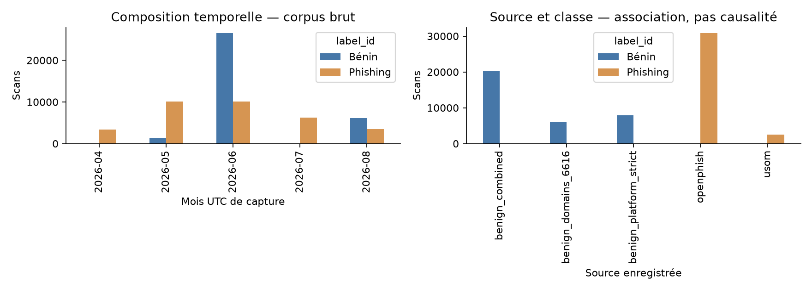
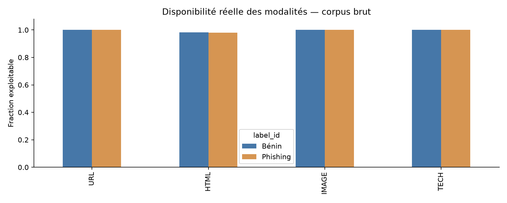
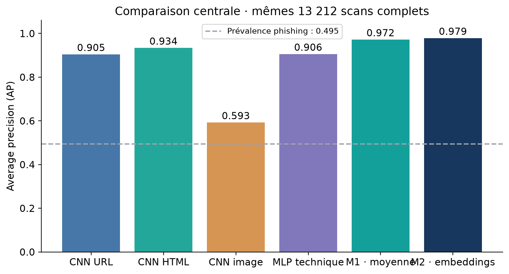
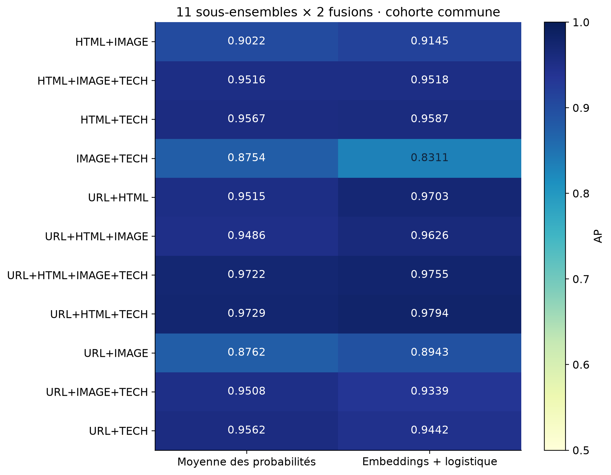
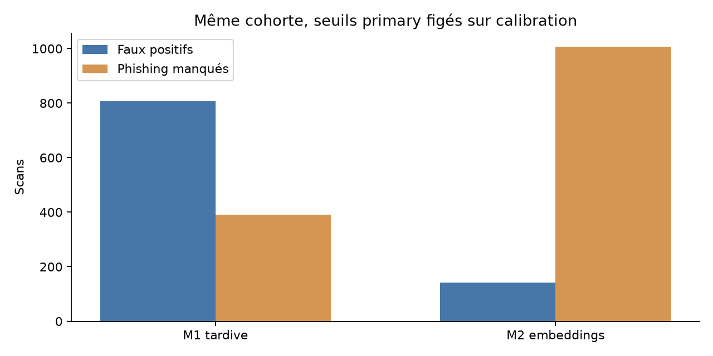
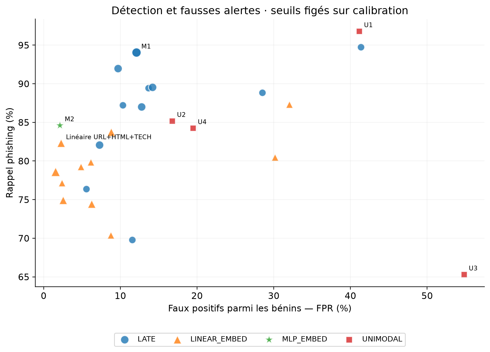
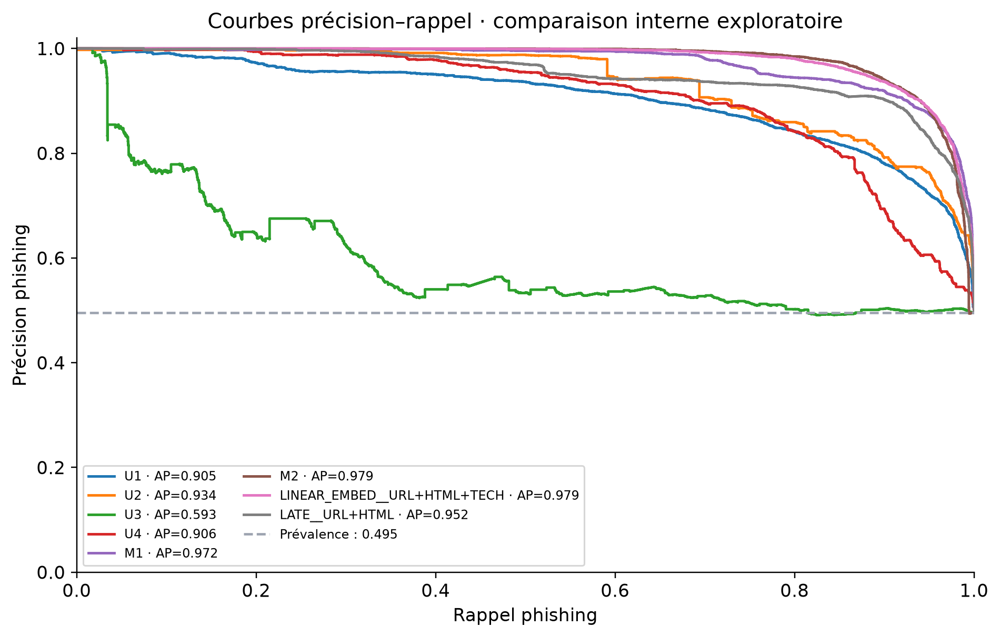
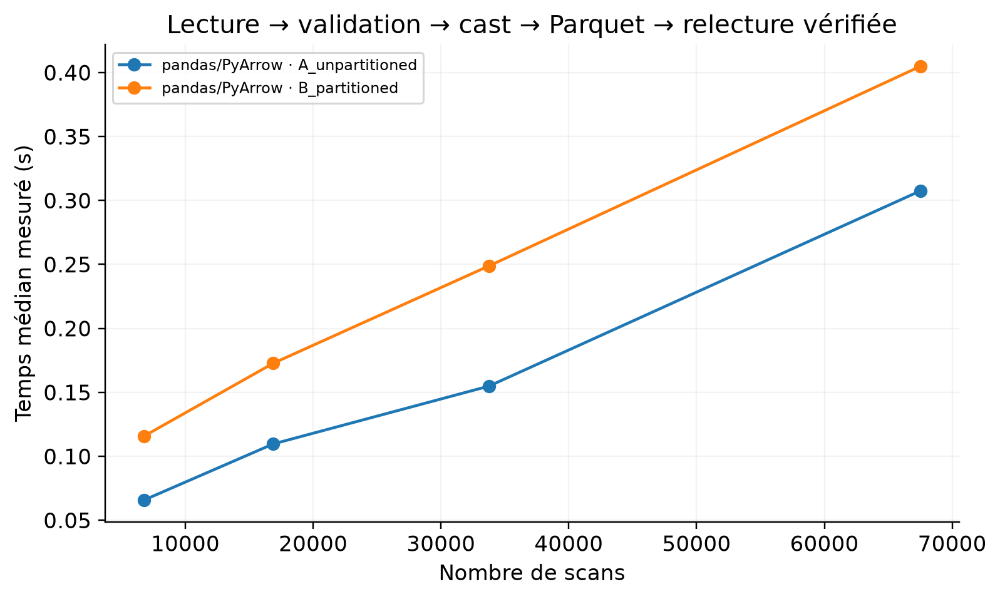
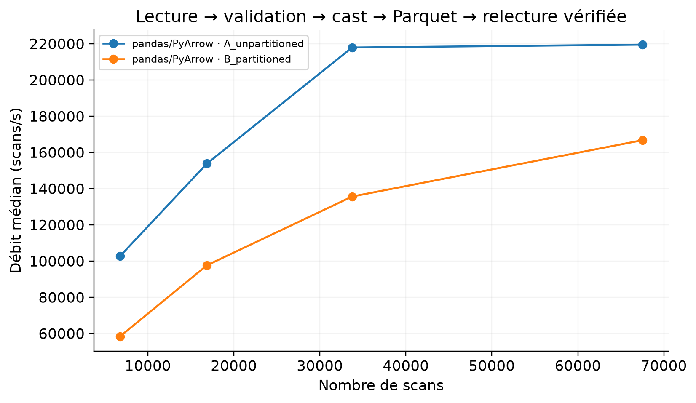

# PhiShark2026 — Détection multimodale du phishing

Mémoire scientifique et expérimental selon CRISP-DM

Version du 26 novembre 2026 — expérience FULL conservée : `77162f55317be0844ec3`.

**Périmètre de preuve.** Ce mémoire développe l'expérience effectivement exécutée dans le projet courant. Les résultats historiques sont préservés ; leurs métriques sont recalculées depuis les prédictions sauvegardées. Aucun entraînement, ajustement de seuil, relabel ou modification du notebook n'est effectué pour la rédaction. L'auteur, l'établissement, l'encadrement et le jury ne sont pas renseignés faute d'informations validées. Ils devront être ajoutés par l'étudiant avant dépôt institutionnel.

## Résumé

La détection du phishing à partir d'une seule URL ignore une partie des preuves disponibles, tandis que l'apparence d'une page ne suffit pas à établir son intention frauduleuse. Ce travail étudie la complémentarité de quatre modalités sur PhiShark2026 : URL, texte HTML, screenshot et caractéristiques techniques. La démarche CRISP-DM relie compréhension de la cible, analyse du corpus, préparation contrôlée, modélisation, évaluation et démonstration locale. L'unité étudiée est un scan associé à une réputation historique, distincte du contenu actuellement visible sur Internet.

Le corpus local contient 67 502 scans. Une observation est mise en quarantaine logique pour une incohérence d'intégrité, sans changement de label. La séparation par identités et contenus distingue entraînement des encodeurs, apprentissage des fusions, validation, calibration des seuils et test. Quatre réseaux compacts produisent des représentations unimodales. Une moyenne de scores disponibles constitue M1 ; un MLP sur embeddings gelés constitue M2. Onze sous-ensembles de modalités sont également évalués par deux méthodes, soit 28 configurations comparées sur les mêmes 13 212 scans complets.

L'AP interne atteint 0,972201 pour M1 et 0,978963 pour M2, contre 0,933933 pour le meilleur unimodal en AP. Ces gains de classement ne suffisent pas à choisir une politique de déploiement : M2 évite 666 faux positifs mais manque 616 phishing supplémentaires aux seuils respectifs déterminés hors test. L'intervalle apparié de différence d'AP entre M2 et M1 contient zéro. Le CNN image est faible dans cette exécution et son ajout ne procure pas un gain systématique.

Les associations entre sources, périodes et classes limitent la portée de ces résultats exploratoires. Le protocole chronologique défini reste non faisable, sa calibration ne contenant aucun bénin après purge. Vingt-quatre mesures pandas/PyArrow sont disponibles ; Spark reste bloqué par les ressources. La contribution consiste en une comparaison traçable et une interprétation des compromis, sans preuve de robustesse externe. Une nouvelle collecte équilibrée et un test indépendant sont nécessaires avant toute revendication opérationnelle.

Mots-clés : phishing ; multimodalité ; CNN ; fusion ; CRISP-DM ; average precision ; biais de collecte ; Parquet ; évaluation groupée.

## Abstract

Detecting phishing from a URL alone ignores potentially useful evidence, whereas visual similarity does not establish fraudulent intent. This study investigates URL, HTML text, screenshots and technical evidence in the local PhiShark2026 corpus. The CRISP-DM framework connects the target definition, exploratory analysis, controlled preparation, modeling, evaluation and an offline demonstration. Labels represent historical URL reputation rather than proof that every captured page displays an active attack.

The corpus contains 67,502 scans, including one integrity-related quarantined observation. Site and content identities are used to separate encoder training, fusion training, checkpoint validation, threshold calibration and testing. Four compact neural branches support a late score average, M1, and an intermediate MLP over frozen embeddings, M2. Eleven modality subsets and two fusion methods extend the study to 28 configurations evaluated on the same 13,212 complete test scans.

Internal average precision is 0.972201 for M1 and 0.978963 for M2, compared with 0.933933 for the strongest unimodal AP. At their frozen thresholds, M2 avoids 666 false positives but misses 616 additional phishing observations. Its paired AP difference against M1 has an interval crossing zero. The compact image branch performs weakly, and adding screenshots does not consistently improve ranking.

These findings remain exploratory. Strong source–label and period–label associations limit the interpretation of historical performance. The defined chronological protocol is not feasible because its post-purge calibration subset contains no benign observations. Twenty-four pandas/PyArrow measurements are available, while the recorded Spark experiment is resource-blocked. The contribution is a reproducible comparison and an explicit account of decision trade-offs, rather than a deployment guarantee. A balanced future collection and an untouched independent evaluation are required.

## Sommaire

- Résumé
- Abstract
- Sigles et conventions
- Chapitre 1 — Introduction générale
- Chapitre 2 — État de l'art et hypothèses
- Chapitre 3 — Compréhension du problème et des données
- Chapitre 4 — Préparation et pipeline Big Data
- Chapitre 5 — Modélisation unimodale et multimodale
- Chapitre 6 — Résultats expérimentaux et discussion
- Chapitre 7 — Passage à l'échelle et généralisation
- Chapitre 8 — Démonstration, conclusion et perspectives
- Bibliographie
- Annexes — Preuves, paramètres et résultats complets

## Sigles et conventions

**Tableau 1 — Sigles et conventions.**

| Terme | Définition et convention dans ce mémoire |
|---|---|
| AP | Average precision, calculée à partir des scores, distincte d'une intégration trapézoïdale arbitraire de la courbe PR. |
| PR / ROC | Précision–rappel / taux de vrais positifs en fonction du taux de faux positifs. |
| FP / FN | Bénin prédit phishing / phishing prédit bénin, selon le label historique du scan. |
| FPR / FNR | FP/(FP+TN) / FN/(FN+TP). Le dénominateur est propre à la classe concernée. |
| CNN / MLP | Réseau convolutif / réseau dense multicouche. |
| DOM | Arbre des éléments HTML ; il n'est pas encodé par GCN dans notre système. |
| TLS / DNS / WHOIS | Transport sécurisé / résolution des noms / enregistrement des domaines. |
| PSL | Public Suffix List, incluant les suffixes privés pour traiter certains locataires. |
| Calibration | Ici, partition de sélection des seuils ; ce terme ne signifie pas calibration probabiliste des scores. |
| Cohorte commune | Sous-ensemble test disposant des quatre modalités exploitables selon les règles du pipeline. |
| Groupe | Composante reliée par les identités effectivement vérifiées, pas une famille sémantique parfaite de campagnes. |
| Résultat interne | Mesure sur le test groupé courant ; aucune assimilation à une validation temporelle ou externe. |

## Liste des figures et tableaux

Les tableaux portent leur population dans le texte et sont fournis en CSV pour réutilisation.

**Tableau 2 — Liste des figures et tableaux.**

| figure | fichier | split |
| --- | --- | --- |
| Figure 1 | FIGURES_ET_RESULTATS/08_EDA_sources_periodes.png | corpus brut |
| Figure 2 | FIGURES_ET_RESULTATS/09_disponibilite_modalites.png | corpus brut |
| Figure 3 | FIGURES_ET_RESULTATS/01_modeles_AP.png | test commun |
| Figure 4 | FIGURES_ET_RESULTATS/02_combinaisons_heatmap.png | test commun |
| Figure 5 | FIGURES_ET_RESULTATS/10_compromis_comptages.png | test commun |
| Figure 6 | FIGURES_ET_RESULTATS/03_compromis_FPR_rappel.png | test commun |
| Figure 7 | FIGURES_ET_RESULTATS/04_precision_recall.png | test commun |
| Figure 8 | FIGURES_ET_RESULTATS/06_bigdata_temps.png | test commun |
| Figure 9 | FIGURES_ET_RESULTATS/07_bigdata_debit.png | benchmark local |

## Chapitre 1 — Introduction générale

### 1.1. Problème de détection et décision de sécurité

Une page de phishing vise à obtenir une action trompeuse, par exemple la saisie d'identifiants, en se faisant passer pour un service attendu. Un filtre automatique doit décider à partir d'indices imparfaits. Une URL peut contenir une longue chaîne légitime de paramètres ; une page malveillante peut posséder un certificat TLS valide. Déduire le label d'un seul indice revient à confondre une corrélation du corpus et une règle de sécurité.

Le coût des erreurs donne son sens à l'évaluation. Un faux positif peut interrompre l'accès à un service autorisé et mobiliser un analyste. Un faux négatif laisse passer une observation annotée phishing. Une même accuracy peut résulter de compromis opposés entre ces coûts. Le mémoire examine donc le classement des scores et la décision à seuil fixé, en conservant séparément leurs interprétations.

Le cas réel M1_FP_01 illustre le problème : l'URL annotée bénigne compte 184 caractères, le statut est 200 et le screenshot est lisible selon le parseur ; M1 produit pourtant un score supérieur à son seuil. Ces métadonnées montrent une erreur de décision, sans démontrer que la longueur de l'URL en est la cause. Ce distinguo entre observation et explication causale gouverne toute l'analyse.

### 1.2. Pourquoi associer quatre modalités ?

Les modalités interrogent des aspects différents d'une capture. L'URL décrit une adresse et une organisation lexicale. Le texte HTML décrit un message extrait. Le screenshot représente une apparence à résolution donnée. Les JSON techniques décrivent des propriétés ou disponibilités de preuves. L'hypothèse multimodale est qu'une observation ambiguë dans un espace puisse être mieux classée lorsqu'un autre fournit une information complémentaire.

Cette hypothèse n'implique ni indépendance des modalités ni amélioration automatique. Une page d'erreur peut produire simultanément un HTML pauvre et une image uniforme. La disponibilité de plusieurs JSON peut dépendre du collecteur ou de l'hébergement. L'ajout d'un score faible dans une moyenne peut dégrader un bon score. La multimodalité crée donc une question expérimentale, pas un argument de performance suffisant.

Notre protocole confronte cette question à une cohorte commune, puis étudie les cas incomplets séparément. Cela permet d'attribuer un écart de métrique à une configuration sur les mêmes observations, tout en reconnaissant la sélection introduite par les cas complets. Les modèles ne seront pas comparés sur des populations silencieusement différentes.

### 1.3. Questions imposées par le sujet

Le document de l'enseignante, lu dans sa copie locale de deux pages, définit trois questions. RQ1 demande si la fusion surpasse chaque modalité isolée. RQ2 demande si cet avantage se maintient sur des campagnes postérieures à l'entraînement. RQ3 demande le coût de calcul selon le volume pour une approche distribuée. Les trois questions ne sont pas interchangeables : un gain interne répond partiellement à RQ1, sans répondre à RQ2 ou démontrer un bénéfice distribué.

La contribution marginale de chaque modalité sert à discuter RQ1. Elle ne remplace pas les obligations de généralisation et de coût. Le statut de chaque question est exposé même lorsqu'un protocole ne peut aboutir. Le résultat « non faisable » est une information sur les conditions de preuve ; il ne constitue ni un score de zéro ni une expérience réussie.

### 1.4. Contributions et limites annoncées

Le projet apporte une chaîne inspectable d'extraction, de regroupement, d'entraînement et d'évaluation ; une comparaison de quatre branches, deux fusions et 22 variantes ; une analyse appariée des contributions ; et une démonstration hors ligne utilisant des poids réels. La rédaction ajoute une lecture critique des résultats et leur rattachement aux hypothèses. Elle ne revendique pas une nouvelle architecture générale de fusion.

Les limites principales sont annoncées avant les résultats : composition de collecte fortement liée aux labels, test déjà examiné, absence de répétitions d'entraînement multi-graines, contrôles exacts ne couvrant pas tous les quasi-doublons et temporalité non démontrée. Ces limites servent à définir ce qu'un lecteur peut conclure. Elles ne sont pas compensées par le nombre de décimales d'une AP.

## Chapitre 2 — État de l'art et hypothèses

### 2.1. Représentations URL : motifs et contexte

Une représentation de caractères conserve la ponctuation, la longueur locale et les segments de l'adresse. Un CNN1D peut apprendre des motifs répétés sans que leur position absolue soit fixe. Une représentation de mots ou de sous-unités associe d'autres régularités, mais dépend d'une segmentation et d'un vocabulaire. Dans les deux cas, les symboles inconnus et la troncature modifient l'information observable.

Notre choix d'un CNN compact permet une branche spécialisée et un embedding fixe. Il reste sensible aux hôtes et chemins propres aux sources du corpus. Retirer le schéma HTTP/HTTPS élimine un raccourci lexical particulier, sans neutraliser l'hébergement, la profondeur des URL ou les locataires. L'état de l'art motive des contrôles de représentation ; il n'autorise pas à déclarer ces biais résolus par une seule normalisation.

### 2.2. Texte HTML et structure DOM

Le HTML offre à la fois des chaînes visibles et une organisation d'éléments. Les méthodes textuelles peuvent reconnaître des vocabulaires ou des séquences, tandis qu'un graphe DOM expose des relations structurelles. Ces choix impliquent des pertes différentes : supprimer les balises simplifie le texte mais abandonne leurs relations ; conserver un graphe exige un parseur et une architecture adaptés.

Yoon et al. [1] associent URL caractères, URL mots et DOM dans une fusion apprise. La revue critique détaille leur validation et leurs ablations, avec repères de section et de tableau. L'enseignement retenu ici est de comparer des représentations complémentaires. Notre U2 traite du texte extrait par HTMLParser : il ne conserve pas les arêtes DOM, n'emploie pas de GCN et n'exécute pas JavaScript. Ses résultats ne sont pas une réimplémentation du modèle de Yoon.

### 2.3. Capture visuelle, marque et intention

Un screenshot peut contenir des indices de mise en page, d'interface et d'identité. Cependant, un classement global d'image n'identifie pas nécessairement la marque ni l'action trompeuse. Réduire une image peut effacer un logo, un champ ou une mention de domaine. Inversement, une apparence de page de connexion existe aussi sur les sites légitimes.

Phishpedia [4] et PhishIntention [5] décrivent des tâches de marque et d'intention plus spécifiques que notre CNN global. La revue les situe à partir des notices officielles, sans prétendre reproduire leurs systèmes. Leurs enseignements servent à éviter une conclusion abusive : une faible AP d'U3 renseigne sur notre représentation et notre population, pas sur l'inutilité universelle de l'image.

### 2.4. Signaux techniques et disponibilité

Les propriétés DNS, TLS, d'enregistrement et de contenu de page peuvent contribuer à une classification. Mais elles sont aussi affectées par la méthode de capture, les permissions, l'expiration d'un service ou les plateformes partagées. L'absence d'une propriété n'est pas nécessairement une propriété négative du site. La distinction entre faux, zéro et inconnu doit être explicitée au niveau des données.

Notre allowlist ne contient pas de source de collecte ni de statut HTTP comme feature directe. Elle contient toutefois des mesures de présence et de compte, accompagnées de masques. Ces informations peuvent devenir des proxys. Les retirer toutes sans expérience supprimerait également une partie du signal. Le mémoire décrit donc précisément leur sémantique et borne les conclusions : leur contribution est mesurée ; leur part causale de biais ne l'est pas.

### 2.5. CrossPhire : apport et différence de protocole

La thèse d'Almakhamreh [2] et l'article de 2026 [3] étudient trois modalités sur plusieurs corpus avec des encodeurs textuels et visuels plus riches. Ils examinent le transfert entre datasets, ce qui constitue un changement réel de population. Ils sont distingués dans la bibliographie et la revue ; leurs configurations et résultats ne sont pas fusionnés en une performance unique.

Le transfert est un enseignement méthodologique pour RQ2, et non une justification de notre AP. Deux datasets peuvent partager des types de sources, des captures ou des périodes ; même un test externe doit donc être décrit. Notre résultat groupé n'est pas placé sur le même axe qu'une accuracy bibliographique. Le choix d'un encodeur plus puissant reste une perspective à évaluer avec le même soin porté aux populations.

### 2.6. Synthèse critique et hypothèses

**Tableau 3 — 2.6. Synthèse critique et hypothèses.**

| Étude | Preuves | Conception | Protocole | Limite de transfert |
| --- | --- | --- | --- | --- |
| Yoon 2024 [1] | URL caractères/mots + DOM | CNN + Transformer + GCN, fusion apprise | Validation croisée ; externe phishing seuls | Complémentarité ; pas notre représentation HTML |
| Thèse 2024 [2] | URL + texte + image | Encodeurs spécialisés, fusion multimodale | Intra/inter-corpus, configurations distinctes | Ne pas assimiler une accuracy à notre AP |
| CrossPhire 2026 [3] | URL + texte + image | Concaténation et mixture of experts | Cinq corpus, transfert | Notre M2 n’est pas une MoE |
| Phishpedia [4] | Visuel + références de marque | Reconnaissance de logos | Comparaison et terrain | Notre CNN ne reconnaît pas explicitement une marque |
| PhishIntention [5] | Apparence + interaction | Analyse d’intention | Comparaison et terrain | Notre système ne navigue pas activement |

Le cadre bibliographique distingue trois niveaux : ce que chaque publication mesure sur son corpus ; l'hypothèse que ce résultat suggère ; et ce que notre expérience permet réellement de constater. Par exemple, la complémentarité justifie H1, mais l'image ne doit pas être déclarée informative avant d'examiner U3 et les contrastes à méthode fixée. L'écart entre M1 et M2 justifie une question de décision différente de la question de classement.

Le registre H1–H15 figure en annexe et dans `scientific/02_HYPOTHESES_ET_PREUVES.md`. H1, H2, H4, H6, H7, H9, H10, H12 et H14 structurent la discussion. Les hypothèses d'équivalence et de causalité disposent d'exigences supplémentaires que les différences ponctuelles de métrique ne satisfont pas. La conclusion reprendra explicitement leurs statuts.

## Chapitre 3 — Compréhension du problème et des données

### 3.1. Définir correctement l'observation et le label

L'unité est un scan identifié par `scan_id`, relié au CSV et à une archive ZIP. Le label binaire est celui de la réputation annotée. Le contenu capturé peut être une page active, une erreur ou une ressource expirée. Il serait incorrect de déduire automatiquement un nouveau label du seul screenshot ou statut HTTP. Le mémoire ne modifie aucun label pour rapprocher les prédictions d'une attente.

Cette définition explique pourquoi certaines erreurs nécessitent une revue plutôt qu'une correction immédiate. Un phishing historiquement signalé peut ne plus afficher son formulaire lors de la capture. Un site bénin peut héberger une page qui ressemble à une connexion frauduleuse. L'annotation et le contenu ne sont pas des mesures identiques d'un même instant. La pertinence opérationnelle d'un classifieur dépend de la cible choisie et de la disponibilité des preuves au moment de la décision.

### 3.2. Composition et périmètres du corpus

**Tableau 4 — 3.2. Composition et périmètres du corpus.**

| label_id | n | min_utc | max_utc | http_404 | image_ok | html_ok | image_uniform | url_length_median |
| --- | --- | --- | --- | --- | --- | --- | --- | --- |
| 0 | 34115 | 2026-05-31 | 2026-08-15 | 4629 | 34115 | 33532 | 1568 | 29.000 |
| 1 | 33387 | 2026-04-23 | 2026-08-15 | 990 | 33387 | 32721 | 1876 | 41.000 |

Les bornes du tableau sont affichées au jour UTC ; les CSV conservent les horodatages complets.

L'effectif brut n'est pas l'effectif d'entraînement ni celui de la comparaison centrale. Une observation en désaccord avec le manifeste d'intégrité est mise en quarantaine logique : elle demeure dans le corpus brut et son label reste inchangé, mais elle ne participe pas à l'expérience principale. Les 67 501 admissibles sont ensuite répartis en cinq rôles. Le test complet contient 13 439 scans ; la comparaison des 28 utilise 13 212 cas complets, soit 98,31 % de ce test.

Cette cascade empêche une confusion fréquente : annoncer 67 502 observations comme si elles avaient toutes été utilisées pour tester chaque modèle. La population et le dénominateur accompagnent chaque figure. Les statistiques d'EDA décrivent le brut ; les tableaux de performance décrivent explicitement le test commun ou le test complet. Les observations exclues ne sont pas assimilées à des erreurs ou succès de classification.

### 3.3. Sources, dates et biais de composition

**Tableau 5 — 3.3. Sources, dates et biais de composition.**

| source_name | label_id | n |
| --- | --- | --- |
| benign_combined | 0 | 20151 |
| benign_domains_6616 | 0 | 6122 |
| benign_platform_strict | 0 | 7842 |
| openphish | 1 | 30878 |
| usom | 1 | 2509 |

Les noms de source observés sont entièrement associés à une classe dans cette copie : le V de Cramér recalculé vaut 1. Cette association descriptive ne signifie pas que le modèle lit directement la colonne source, qui est exclue de ses entrées. Elle signifie que des caractéristiques indirectes de la capture ou de l'hébergement peuvent également séparer les sources et donc les labels. Le retrait des colonnes évidentes ne suffit pas à éliminer cette possibilité.

**Tableau 6 — 3.3. Sources, dates et biais de composition.**

| period | label_id | n |
| --- | --- | --- |
| 2026-04 | 1 | 3388 |
| 2026-05 | 0 | 1428 |
| 2026-05 | 1 | 10098 |
| 2026-06 | 0 | 26565 |
| 2026-06 | 1 | 10136 |
| 2026-07 | 1 | 6275 |
| 2026-08 | 0 | 6122 |
| 2026-08 | 1 | 3490 |

Les distributions temporelles sont également différentes. Les phishing commencent avant les bénins et certains mois ne contiennent qu'une classe. Une coupe chronologique peut donc changer simultanément période, prévalence et source. Ce constat fournit une explication de l'infaisabilité observée du protocole, mais ne démontre pas à lui seul la cause de chaque erreur future. Une collecte plus équilibrée doit être conçue avant le prochain entraînement.

### 3.4. Disponibilité et qualité des captures

**Tableau 7 — 3.4. Disponibilité et qualité des captures.**

| classe | n | URL | HTML | IMAGE | TECH | images_uniformes |
| --- | --- | --- | --- | --- | --- | --- |
| Bénin | 34115 | 34115 | 33532 | 34115 | 34115 | 1568 |
| Phishing | 33387 | 33387 | 32721 | 33387 | 33387 | 1876 |

Une image décodable est disponible pour tous les scans de ce cache, ce qui n'implique pas une image informative. Les captures quasi uniformes sont comptées séparément. Le texte HTML exploitable manque pour une partie des observations, même si un fichier HTML ou une image existe. La disponibilité technique signifie qu'au moins une des mesures autorisées est finie ; elle ne garantit pas l'exhaustivité des JSON.

Le corpus brut contient 66 253 scans complets selon les règles de disponibilité. Ce nombre diffère de la cohorte test commune, qui applique aussi le rôle test et l'admissibilité. Le masque reflète cette définition opérationnelle. Une absence de contenu ne doit pas être remplacée par un exemple fictif ; lorsqu'aucune modalité demandée n'est disponible, les combinaisons s'abstiennent.

### 3.5. HTTP, durée enregistrée et sens des valeurs

Le brut contient 4 629 statuts 404 chez les bénins et 990 chez les phishing. Un statut 404 est un résultat de capture, pas une classe. Sa fréquence dépend notamment de la composition des URL et de l'instant d'observation. Les valeurs de statut hors intervalle valide, dont zéro, sont traitées comme inconnues dans le pipeline ; elles ne constituent pas un nouveau code HTTP.

Les 67 502 durées calculées comme `scan_finished_at - scan_created_at` sont négatives dans le cache actuel. Cette anomalie systématique interdit d'interpréter ce champ comme un temps physique de capture. Les dates ne sont pas inversées pour obtenir des valeurs positives ; leur sémantique doit être clarifiée auprès du producteur. Les chronométrages d'extraction et d'entraînement rapportés plus loin proviennent d'autres mesures et ne reposent pas sur ces durées.

Ce résultat est une limite de métadonnées à documenter, pas une raison de supprimer silencieusement les observations. Les champs concernés restent hors des entrées des modèles. La généralisation chronologique utilise l'horodatage déclaré et doit être lue avec cette réserve sur la sémantique des dates.

### 3.6. Exemples locaux anonymisés et risques de validité

Les cas M1_FP_01 et M2_FN_16 sont issus des prédictions réellement enregistrées. Le premier est une observation bénigne avec HTTP 200 et trois features techniques manquantes ; le second est un phishing historique avec HTTP 404, image uniforme et huit features manquantes. Dans les deux cas, le résultat du modèle contredit le label. Aucun de ces éléments ne suffit à conclure que le label est faux ou à attribuer causalement l'erreur à une seule modalité.

Les exemples sont pseudonymisés ; le registre de correspondance reste dans les artefacts privés. Aucun domaine, lien actif, cookie ou texte de formulaire n'est publié. Les descriptions sont structurées à partir des métadonnées, pas présentées comme une inspection humaine des captures. Le chapitre 6 distingue ces cas illustratifs des taux calculés sur l'ensemble du test.

Les risques sont de quatre types : validité de construit entre réputation et capture ; validité interne face aux proxys et répétitions ; validité externe face aux périodes et sources nouvelles ; validité statistique face aux dépendances et comparaisons multiples. Le protocole réduit certains risques contrôlables, sans supprimer les autres par déclaration.

## Chapitre 4 — Préparation et pipeline Big Data

### 4.1. De l'index CSV aux preuves brutes

Le CSV sert à associer identité, label et fichier d'archive ; il n'est pas un ensemble de features librement utilisables. Les ZIP contiennent des JSON, du HTML et des screenshots. Le pipeline contrôle les membres, tailles et empreintes avant extraction. La lecture n'exécute ni HTML ni JavaScript et ne visite pas de site. Cette séparation évite de mêler les variations du Web actuel à une expérience sur captures figées.

Les erreurs de lecture, indisponibilités et désaccords d'intégrité deviennent des états explicites. L'observation incohérente est mise en quarantaine logique, tandis que les captures incomplètes peuvent rester utilisables par certaines branches. Cette distinction évite d'assimiler une modalité absente à une corruption globale de tous les indices. Les règles d'admissibilité et de disponibilité sont donc des objets différents.

### 4.2. URL et texte HTML : transformations cohérentes

L'URL est convertie en hôte, chemin et query, en minuscules, sans schéma ni fragment. Cette transformation est identique pour vocabulaire, audit d'entrée, entraînement et inférence. U1 observe au plus 256 caractères. Par exemple, une URL de 184 caractères dans le cas réel M1_FP_01 entre dans une séquence de longueur fixe, complétée par PAD si nécessaire. Le rapport ne publie pas l'adresse d'origine.

Le HTML est décodé en tolérant les caractères invalides ; HTMLParser accumule les données textuelles hors script, style et noscript. Les espaces et la casse sont normalisés avant tokenisation. U2 observe au plus 1 024 tokens et utilise un vocabulaire ajusté sur train_encoder. Il s'agit d'un texte extrait sans calcul de visibilité CSS : ce n'est ni un DOM conservé ni un rendu de navigateur. Une page dynamique dont le texte n'existe qu'après JavaScript reste une limite du procédé.

La cohérence des transformations protège contre une divergence entraînement–inférence, mais elle crée aussi des collisions : des observations différentes peuvent devenir la même séquence après normalisation ou encodage UNK. Le partitionnement vérifie donc les entrées réellement encodées, au-delà des seules URL brutes.

### 4.3. Image et mesures techniques

Les captures sont converties en RGB et redimensionnées en 96×96. Les valeurs utilisées par U3 sont ramenées dans l'intervalle 0–1 par division par 255. Il n'y a ni normalisation ImageNet déclarée ni poids visuels préentraînés. Cette transformation rend le calcul peu coûteux, tout en perdant potentiellement du texte fin et des petits logos. Cette perte est une propriété du système, pas une explication causale déjà isolée de son AP.

Les JSON sont lus suivant une allowlist de 21 mesures. Les opérations sont des comptes, présences, longueurs, booléens ou nombres non négatifs. Une date WHOIS présente n'est pas un âge de domaine : aucune soustraction d'années n'est inventée. La présence d'une chaîne et son absence ne sont pas nécessairement synonymes de succès et d'échec d'un protocole. Le dictionnaire exhaustif des champs est donné en annexe.

Les inconnus numériques restent des NaN. Pour U4, la médiane d'entraînement remplace les absences, puis les valeurs sont centrées et réduites avec les statistiques d'entraînement. Vingt et un indicateurs manquants sont concaténés aux 21 valeurs, soit 42 entrées. L'exemple d'une mesure absente illustre l'intérêt : une valeur imputée peut être identique à une mesure réelle médiane, mais le masque permet de les distinguer. Cette information peut être utile ou refléter la collecte ; son rôle doit être analysé avec prudence.

### 4.4. Stockage, provenance et reproductibilité

Le stockage Parquet/PyArrow conserve un schéma et permet de relire un sous-ensemble de colonnes. Les images transformées sont mises en cache séparément. Le calcul est versionné à partir du code, de la configuration et des empreintes d'entrée. Une modification du notebook ne réattribue pas les anciens poids à une nouvelle signature ; elle constitue une nouvelle expérience possible.

Le notebook actif contient tout le code scientifique et distingue PRESENTATION et FULL_EXPERIMENT. Le premier lit les résultats publiés sans charger les réseaux. Le second pourrait reconstruire la chaîne et produire de nouveaux artefacts ; il n'a pas été lancé pour ce mémoire. La provenance des poids existants est conservée comme source immuable séparée, sans second notebook actif. Les manifestes lient les fichiers aux résultats, mais n'affirment pas l'absence de biais scientifiques.

### 4.5. Identités, contenus et construction des groupes

Une séparation aléatoire de scans peut placer le même site, une URL normalisée ou un contenu identique de part et d'autre. Le pipeline relie les identités de site ou de locataire et les empreintes contrôlées en composantes. Les suffixes privés de la PSL contribuent à distinguer certains locataires de plateformes partagées. Une plateforme entière ne doit pas être confondue automatiquement avec une seule entité autonome.

Le contrôle des entrées encodées fusionne également des groupes lorsque l'encodage courant crée des collisions. La stabilisation est monotone : les composantes ne se divisent pas arbitrairement d'une itération à l'autre. Cette précaution évite qu'un même tenseur connu soit vu comme une entrée indépendante de test. Elle ne démontre pas l'absence de templates proches mais non identiques ou de campagnes partageant une marque.

**Tableau 8 — 4.5. Identités, contenus et construction des groupes.**

| identity | identities | cross_partition_identities |
| --- | --- | --- |
| group_id | 35038 | 0 |
| site_id | 49339 | 0 |
| normalized_url | 63555 | 0 |
| raw_html_hash | 56124 | 0 |
| url_input_hash | 62931 | 0 |
| html_input_hash | 46644 | 0 |
| image_input_hash | 48767 | 0 |
| encoding_component | 35038 | 0 |

Les contrôles recalculés portent sur huit clés présentes et ne détectent aucun recouvrement entre rôles pour ces clés. La formulation est volontairement limitée aux identités observables. Nous ne transformons pas cette absence de recouvrement exact en certification d'indépendance sémantique.

### 4.6. Cinq rôles et ajustements train-only

**Tableau 9 — 4.6. Cinq rôles et ajustements train-only.**

| split | benign | phishing | n |
| --- | --- | --- | --- |
| calibration | 1706 | 1665 | 3371 |
| test | 6823 | 6616 | 13439 |
| train_encoder | 17058 | 16309 | 33367 |
| train_fusion | 5117 | 5473 | 10590 |
| validation | 3411 | 3323 | 6734 |

train_encoder ajuste vocabulaires, imputation, normalisation et poids des branches. train_fusion apprend la combinaison de représentations sur d'autres observations. validation choisit le meilleur checkpoint par AP. calibration fixe les seuils. test mesure les performances sans ajuster les poids ni les décisions. Les fractions cibles peuvent différer des effectifs exacts parce que les groupes sont indivisibles.

Cette séparation évite d'entraîner le méta-modèle sur des représentations de scans que les encodeurs viennent d'apprendre par cœur. Elle coûte une partie du volume disponible à chaque étape, mais clarifie les rôles. La normalisation des embeddings est ajustée sur train_fusion, pas sur la cohorte de test. Les encodeurs restent gelés pendant l'apprentissage des têtes supplémentaires.

La distinction validation/calibration est méthodologique : choisir un checkpoint et choisir une règle de décision ne sont pas la même opération. Elle ne supprime pas les dépendances induites par plusieurs modèles utilisant le même jeu de validation. La répétition des analyses du test rend ensuite les comparaisons exploratoires, même lorsque chaque étape informatique respecte son rôle initial.

## Chapitre 5 — Modélisation unimodale et multimodale

### 5.1. Contrat commun des branches

Les quatre branches associent une entrée spécialisée à un embedding de 32 valeurs et un logit. Pendant l'apprentissage, la perte utilise le logit directement ; pour les métriques, une sigmoid produit un score entre 0 et 1. Ce score n'est pas une probabilité de risque externe calibrée. Les masques de disponibilité sont déterminés avant la fusion et les identifiants restent alignés aux lignes de prédiction.

Un embedding est une représentation apprise qui n'attribue pas nécessairement un sens humain à chaque coordonnée. Son intérêt est d'exposer à la tête de fusion davantage d'information qu'une seule probabilité. Ce choix accroît aussi le nombre de paramètres et le risque d'apprentissage de corrélations propres au corpus. La comparaison M1/M2 mesure un système complet avec son protocole de seuil ; elle ne isole pas tous ces mécanismes séparément.

### 5.2. CNN1D URL et HTML

**Tableau 10 — 5.2. CNN1D URL et HTML.**

| Étape | U1 | U2 | Précision |
| --- | --- | --- | --- |
| Indices | B×256 | B×1024 | Caractères URL / tokens HTML |
| Embedding 24 | B×256×24 | B×1024×24 | PAD=0 ; vocabulaire train seul |
| Conv1d 24→48, k5/s2/p2 | B×48×128 | B×48×512 | ReLU |
| Conv1d 48→32, k3/s2/p1 | B×32×64 | B×32×256 | ReLU |
| AdaptiveMaxPool1d(1) | B×32 | B×32 | Embedding exporté |
| Dropout 0,25 + Linear32→1 | B | B | Logit puis sigmoid en inférence |

Les deux réseaux partagent une architecture, mais ni le vocabulaire ni la granularité de l'entrée. L'embedding de 24 valeurs transforme un identifiant discret en vecteur. Les convolutions 24→48 puis 48→32 utilisent des noyaux de 5 et 3, des strides de 2 et des activations ReLU. Le max-pooling adaptatif réduit la dimension de longueur et conserve un vecteur de 32 valeurs. La tête applique un dropout de 0,25 puis une projection vers un logit.

Pour U1, une longueur fixe de 256 impose un budget de lecture de l'adresse ; une partie finale peut être perdue pour les URL longues. Pour U2, 1 024 tokens représentent un compromis de calcul, sans garantie de contenir tous les indices d'une grande page. Les vocabulaires sont ajustés exclusivement sur l'entraînement des encodeurs. Le pooling facilite une sortie fixe mais perd une partie de l'ordre fin : l'architecture n'est pas un analyseur de structure HTML.

### 5.3. CNN screenshot

**Tableau 11 — 5.3. CNN screenshot.**

| Étape U3 | Tenseur | Précision |
| --- | --- | --- |
| RGB normalisé | B×3×96×96 | Division par 255 |
| Conv k5/s2/p2 + BN/ReLU | B×24×48×48 | 3→24 canaux |
| Conv k3/s2/p1 + BN/ReLU | B×48×24×24 | 24→48 |
| Conv k3/s2/p1 + BN/ReLU | B×64×12×12 | 48→64 |
| AdaptiveAvgPool2d(2,2) | B×64×2×2 | 256 valeurs aplaties |
| Linear256→64/ReLU/Dropout0,2 | B×64 | Projection |
| Linear64→32/ReLU | B×32 | Embedding |
| Linear32→1 | B | Logit |

U3 emploie trois convolutions avec BatchNorm et ReLU : 3→24→48→64 canaux. Les trois strides de 2 ramènent une image 96×96 à des cartes 12×12 avant pooling adaptatif 2×2. Les 256 valeurs sont projetées en 64 puis 32 ; le dropout de cette projection vaut 0,2. Une tête linéaire produit le logit. Aucune préconnaissance de marque n'est fournie à ce réseau entraîné depuis zéro.

Cette architecture permet une baseline visuelle compacte mais ne peut être présentée comme un ResNet de l'état de l'art. L'analyse ultérieure examine son signal observé, la qualité des captures et ses contributions marginales. Pour attribuer causalement sa faiblesse à la résolution, il faudrait conserver les partitions et comparer des résolutions selon un budget contrôlé, sans consulter le test pour choisir la meilleure.

### 5.4. MLP technique et choix d'optimisation

U4 reçoit 42 valeurs : mesures standardisées et masques. Le MLP applique 42→64, ReLU, dropout 0,25, puis 64→32, ReLU, et 32→1. La structure dense convient à ce vecteur numérique, sans imposer une notion artificielle de voisinage spatial entre champs DNS et TLS. La présence de masques ne garantit pas la robustesse : une tête peut s'appuyer fortement sur la disponibilité si celle-ci corrèle au label.

Les modèles utilisent AdamW, un learning rate de 0,001, un weight decay de 0,0001 et une BCEWithLogits pondérée selon le rapport de classes du train propre à la branche. Le batch vaut 32 ; le budget maximal est de dix époques avec patience deux. Le meilleur checkpoint maximise l'AP de validation et est restauré avant export. Ces valeurs décrivent l'expérience exécutée, pas des hyperparamètres démontrés optimaux par recherche exhaustive.

**Tableau 12 — 5.4. MLP technique et choix d'optimisation.**

| model | best_epoch | validation_AP | train_seconds | parameters | device |
| --- | --- | --- | --- | --- | --- |
| U1 | 8 | 0.993029 | 188.058 | 11873 | cpu |
| U2 | 9 | 0.980964 | 469.649 | 394481 | cpu |
| U3 | 2 | 0.753943 | 505.998 | 58785 | cpu |
| U4 | 3 | 0.924991 | 171.303 | 4865 | cpu |
| M2 | 6 | 0.998437 | 40.680 | 10625 | cpu |

Les temps enregistrés ne sont pas comparables à une collecte de nouvelles pages ni à une latence utilisateur. Ils concernent l'apprentissage local sur les caches déjà extraits. Le temps de M2 ne comprend pas toute la préparation des embeddings. Une somme de durées partielles ne constituerait pas un coût complet de production.

### 5.5. M1 : moyenne des scores disponibles

Pour un scan i et des masques m(i,j), M1 calcule la somme des scores p(i,j) des branches disponibles, divisée par la somme de leurs masques. La règle conserve des poids égaux renormalisés. Elle n'apprend pas un modèle supplémentaire et ne doit pas être appelée stacking. Lorsque seule une modalité est disponible, sa moyenne est simplement son score ; lorsque rien n'est disponible, aucun score valide ne peut être produit.

La simplicité de M1 constitue une baseline importante. Elle permet de comparer l'ajout d'une modalité sans modifier un méta-modèle complexe. Mais des scores de branches de qualité ou d'échelle différentes ne sont pas nécessairement comparables comme probabilités calibrées. Une branche faible peut perturber la moyenne. Les sous-ensembles permettent d'examiner cet effet empiriquement.

### 5.6. M2 : fusion intermédiaire sur encodeurs gelés

Les quatre embeddings de 32 valeurs sont concaténés avec quatre masques : 4×32+4=132 entrées. Les embeddings manquants sont représentés par des zéros et le masque précise la disponibilité. Une normalisation ajustée sur train_fusion précède le MLP 132→64→32→1, avec les mêmes types d'activation et dropout que la tête dense. Les poids des encodeurs ne sont pas mis à jour pendant cet apprentissage.

Cette fusion peut apprendre des interactions qu'une moyenne ne représente pas. Elle reste dépendante de la qualité des embeddings et de la composition de train_fusion. Elle n'est ni une mixture of experts ni un entraînement conjoint de bout en bout. Les quatre masques donnent une information de disponibilité à la tête, sans garantir le comportement sur des motifs d'absence peu rencontrés.

### 5.7. Les 22 combinaisons et leurs dépendances

Les onze sous-ensembles comprennent six paires, quatre triplets et le quadruplet. Chaque ensemble est évalué par LATE et LINEAR_EMBED. Dans LINEAR_EMBED, un StandardScaler et une régression logistique sont ajustés sur train_fusion ; les paramètres déclarés sont C=1, max_iter=500 et class_weight=balanced. Cette tête est distincte de M2, qui est un MLP. Les deux ne doivent pas être confondus sous l'étiquette unique « fusion intermédiaire » sans précision.

Les encodeurs sont partagés entre les variantes. La ligne LATE à quatre modalités reprend fonctionnellement M1, avec de très petits écarts possibles d'arrondi numérique dans les scores. Les 28 lignes ne sont donc pas 28 preuves indépendantes. Ce partage limite le coût et rend les contrastes possibles, tout en imposant une analyse appariée et une prudence face aux comparaisons multiples.

**Tableau 13 — 5.7. Les 22 combinaisons et leurs dépendances.**

| sous_ensemble | méthodes | modalités |
| --- | --- | --- |
| URL+HTML | LATE ; LINEAR_EMBED | 2 |
| URL+IMAGE | LATE ; LINEAR_EMBED | 2 |
| URL+TECH | LATE ; LINEAR_EMBED | 2 |
| HTML+IMAGE | LATE ; LINEAR_EMBED | 2 |
| HTML+TECH | LATE ; LINEAR_EMBED | 2 |
| IMAGE+TECH | LATE ; LINEAR_EMBED | 2 |
| URL+HTML+IMAGE | LATE ; LINEAR_EMBED | 3 |
| URL+HTML+TECH | LATE ; LINEAR_EMBED | 3 |
| URL+IMAGE+TECH | LATE ; LINEAR_EMBED | 3 |
| HTML+IMAGE+TECH | LATE ; LINEAR_EMBED | 3 |
| URL+HTML+IMAGE+TECH | LATE ; LINEAR_EMBED | 4 |

### 5.8. Seuils, calibration et préservation du test

La politique primary choisit le seuil maximisant le F1 sur calibration ; en cas d'égalité à la tolérance numérique du code, le seuil le plus élevé est retenu. La politique recall85 choisit le seuil le plus élevé maintenant au moins 85 % de rappel sur calibration. Le code exige les deux classes et des scores finis. Le rôle calibration ne contient pas un apprentissage de Platt ou une régression isotone : les probabilités ne sont pas recalibrées par ces méthodes.

Les seuils sont figés avant l'inférence test. Les modifier après observation des erreurs rendrait le test participant à la sélection. Le présent mémoire compare seulement les politiques déjà enregistrées. Un rappel de calibration de 85 % n'est pas une promesse de rappel test, comme le montrent les résultats du chapitre suivant. Tout protocole futur doit définir son objectif opérationnel sur une validation historique distincte, puis conserver une évaluation scellée.

## Chapitre 6 — Résultats expérimentaux et discussion

### 6.1. Population comparée et contrat de lecture

L'objectif prioritaire est de déterminer ce que les fusions changent sur les mêmes individus. Chaque configuration est évaluée sur 13 212 identifiants communs, dont 6 544 phishing et 6 668 bénins. La prévalence vaut 0,495307. Les 5 230 groupes de la cohorte définissent l'unité du bootstrap. Les résultats des 13 439 scans du test complet sont présentés séparément : ils ne constituent pas le dénominateur des matrices de ce chapitre.

La nouvelle vérification relit les scores non arrondis, aligne les identifiants, applique les seuils gelés et recalcule AP, ROC-AUC et matrices. Les 28 lignes concordent à la tolérance numérique fixée avec les CSV publiés. Ce contrôle montre la cohérence des artefacts ; il ne démontre pas une vérité universelle des labels ni une bonne généralisation. Les prédictions et le test ont déjà été consultés, de sorte que cette comparaison doit rester exploratoire.

Les configurations n'ont pas toutes le même nombre de paramètres ni le même mécanisme de fusion, mais la population reste fixe. Cela évite de confondre une AP plus haute et une cohorte plus facile. La restriction aux cas complets peut toutefois exclure des pages difficiles à capturer. Son coût de couverture est documenté, et les tableaux secondaires conservent les observations disponibles pour chaque combinaison.

### 6.2. Définir les métriques avant de les interpréter

La précision mesure la fraction de phishing étiquetés parmi les alertes. Le rappel mesure la fraction de phishing retrouvés. Le FPR rapporte les fausses alertes au nombre de bénins ; le FNR rapporte les phishing manqués au nombre de phishing. Le F1 est la moyenne harmonique de précision et rappel. Ces définitions ne donnent pas le même poids aux erreurs et leurs dénominateurs doivent rester visibles.

L'exemple M1 fournit un calcul contrôlable : précision=6 154/(6 154+807)=0,884068 ; rappel=6 154/(6 154+390)=0,940403 ; FPR=807/(807+5 861)=0,121026. Une précision élevée et un FPR non négligeable peuvent coexister, parce qu'ils ne divisent pas par la même population. Une précision de test proche de 0,88 ne sera pas nécessairement celle d'un flux opérationnel beaucoup moins riche en phishing.

AP résume le classement aux changements de rappel, suivant la définition d'average precision utilisée dans le code. Elle ne dépend pas du choix final primary ou recall85 lorsque les scores restent identiques. La courbe PR porte une référence de prévalence. ROC-AUC décrit un autre aspect du classement et ne remplace pas le contrôle des fausses alertes. Saito et Rehmsmeier [8] motivent l'attention aux courbes PR ; notre corpus quasi équilibré et un futur flux opérationnel déséquilibré restent des populations différentes.

La sigmoid borne un logit entre 0 et 1, mais ne garantit pas que 0,8 signifie 80 % de risque en déploiement. Le sous-ensemble nommé calibration a servi à choisir des seuils, sans calibrateur probabiliste supplémentaire. AP, seuil et calibration probabiliste sont trois notions séparées. Les amalgamer rendrait l'interprétation du score de l'interface trompeuse.

### 6.3. Vue d'ensemble des six modèles centraux

**Tableau 14 — 6.3. Vue d'ensemble des six modèles centraux.**

| model | modalities | AP | ROC_AUC | threshold |
| --- | --- | --- | --- | --- |
| U1 | URL | 0.904653 | 0.912008 | 0.152665 |
| U2 | HTML | 0.933933 | 0.931594 | 0.421088 |
| U3 | IMAGE | 0.592764 | 0.564554 | 0.075273 |
| U4 | TECH | 0.905998 | 0.891613 | 0.368182 |
| M1 | URL+HTML+IMAGE+TECH | 0.972201 | 0.972027 | 0.380406 |
| M2 | URL+HTML+IMAGE+TECH | 0.978963 | 0.974059 | 0.753241 |

**Tableau 15 — 6.3. Vue d'ensemble des six modèles centraux.**

| model | precision | recall | F1 | FPR | FNR | FP | FN |
| --- | --- | --- | --- | --- | --- | --- | --- |
| U1 | 0.697841 | 0.968062 | 0.811036 | 0.411368 | 0.031938 | 2743 | 209 |
| U2 | 0.833084 | 0.851925 | 0.842400 | 0.167516 | 0.148075 | 1117 | 969 |
| U3 | 0.539102 | 0.653117 | 0.590658 | 0.547990 | 0.346883 | 3654 | 2270 |
| U4 | 0.809454 | 0.842604 | 0.825696 | 0.194661 | 0.157396 | 1298 | 1030 |
| M1 | 0.884068 | 0.940403 | 0.911366 | 0.121026 | 0.059597 | 807 | 390 |
| M2 | 0.975172 | 0.846271 | 0.906161 | 0.021146 | 0.153729 | 141 | 1006 |

Les deux fusions centrales ont une AP supérieure à celle de chaque unimodal sur cette cohorte. Le meilleur unimodal en AP est le CNN HTML, U2. L'URL et la technique contiennent également un signal important, tandis qu'U3 reste nettement plus faible. Ces constats répondent au cœur de RQ1 sur une population et une exécution définies. Ils ne justifient pas l'affirmation que toute fusion ou toute modalité additionnelle améliore les résultats.

Le critère choisi change aussi l'ordre. M2 a une AP plus élevée que M1, alors que son F1 primary est inférieur et son rappel plus faible. U1 atteint un rappel élevé au prix de nombreuses fausses alertes. Les tableaux de classement et de décision sont séparés pour rendre ces différences lisibles. Le seuil est une partie du système évalué ; il n'est pas choisi pour embellir la matrice présentée.

### 6.4. URL, HTML et technique : informations et erreurs résiduelles

U1 réalise un rappel de 0,968062 au seuil primary, avec 2 743 faux positifs. La normalisation retire HTTP/HTTPS et le fragment, mais l'hôte, le chemin et la query demeurent observables. Le score peut exploiter des régularités de sources ou de plateformes. L'absence de source explicite dans l'entrée n'est donc pas la preuve que le modèle a appris uniquement des signes sémantiques du phishing.

U2 atteint une AP de 0,933933, mais sa représentation est limitée au texte extrait et tronqué. Les pages riches en scripts ou les indices structurels non textuels ne sont pas modélisés comme tels. Une bonne performance textuelle peut refléter des messages de formulaire, des pages d'erreur ou des signatures de collecte ; l'AP seule ne permet pas de distribuer la contribution entre ces mécanismes. Les cas doivent être examinés sans réécrire les labels à partir des prédictions.

U4 atteint une AP de 0,905998 et utilise explicitement les indicateurs manquants. Ses 42 entrées décrivent des propriétés de preuves plutôt qu'une liste universelle de critères malveillants. Les comptes de liens, redirections et preuves techniques peuvent compléter une URL ambiguë. Mais les proxys de collecte restent possibles, puisque source et classe sont associées dans le corpus. La part exacte du score historique due à ces proxys n'est pas causalement mesurée dans l'exécution finale.

Un écart de validation à test ne doit pas être attribué à une seule cause. Les sites, contenus et cas disponibles changent ; le checkpoint a été choisi sur validation ; et l'échantillonnage des groupes peut modifier la difficulté. Le recul d'AP d'U1 ou U3 indique une sensibilité de généralisation interne, sans identifier à lui seul un bug ou une fuite résiduelle.

### 6.5. CNN image : résultat faible et explications non confondues

U3 obtient une AP de 0,592764 pour une prévalence commune de 0,495307, une ROC-AUC de 0,564554 et 3 654 faux positifs à son seuil primary. Il serait excessif d'affirmer qu'il n'existe aucun signal visuel ; il serait tout aussi excessif de présenter cette branche comme une contribution forte. Le constat est celui d'une discrimination modeste dans le système exécuté.

Quatre mécanismes sont plausibles : perte de détails à 96×96, capacité d'un petit CNN entraîné depuis zéro, captures d'erreur ou uniformes et distribution propre aux sites séparés en groupes. Les données EDA confirment l'existence de captures uniformes et de statuts 404, mais elles ne démontrent pas que ces éléments causent toute la faiblesse d'U3. Nous n'avons pas isolé l'effet de la résolution, du préentraînement ou de la langue par une expérience contrôlée dédiée.

Les architectures de marque des références ne peuvent pas servir à attribuer rétrospectivement au CNN des capacités qu'il ne possède pas. Une étude future pourrait comparer une représentation préentraînée et une autre résolution, avec mêmes groupes et budget de sélection, puis évaluation indépendante. Elle ne sera pertinente qu'après contrôle des sources et des cibles. Relancer un réseau plus grand pour obtenir une valeur attendue ne répondrait pas à cette exigence.

Les ablations renforcent la lecture prudente : ajouter IMAGE à certaines combinaisons détériore leur AP. Ce résultat concerne une branche donnée et une famille de fusion donnée. Il ne signifie pas qu'un screenshot est inutile à l'analyste humain ni qu'une autre représentation ne pourrait pas compléter le texte.

### 6.6. Combinaisons bimodales : comparer à méthode fixée

**Tableau 16 — 6.6. Combinaisons bimodales : comparer à méthode fixée.**

| model | AP | ROC_AUC | F1 | FPR | FNR |
| --- | --- | --- | --- | --- | --- |
| LATE__URL+HTML | 0.951510 | 0.955576 | 0.838915 | 0.055789 | 0.236400 |
| LINEAR_EMBED__URL+HTML | 0.970345 | 0.967509 | 0.859088 | 0.023995 | 0.228606 |
| LATE__URL+IMAGE | 0.876205 | 0.894213 | 0.799768 | 0.413767 | 0.052720 |
| LINEAR_EMBED__URL+IMAGE | 0.894263 | 0.885354 | 0.793803 | 0.320486 | 0.126987 |
| LATE__URL+TECH | 0.956183 | 0.953586 | 0.882071 | 0.103329 | 0.127903 |
| LINEAR_EMBED__URL+TECH | 0.944202 | 0.944950 | 0.857870 | 0.061638 | 0.201711 |
| LATE__HTML+IMAGE | 0.902193 | 0.900299 | 0.815345 | 0.285243 | 0.111705 |
| LINEAR_EMBED__HTML+IMAGE | 0.914526 | 0.902768 | 0.784899 | 0.087732 | 0.296302 |
| LATE__HTML+TECH | 0.956747 | 0.954498 | 0.879471 | 0.136773 | 0.105746 |
| LINEAR_EMBED__HTML+TECH | 0.958731 | 0.953998 | 0.860295 | 0.048740 | 0.207671 |
| LATE__IMAGE+TECH | 0.875439 | 0.870916 | 0.768622 | 0.115627 | 0.302262 |
| LINEAR_EMBED__IMAGE+TECH | 0.831059 | 0.825486 | 0.761884 | 0.301740 | 0.195446 |

URL+HTML, URL+TECH et HTML+TECH illustrent une complémentarité interne de modalités déjà informatives. Les ensembles comportant l'image ne sont pas systématiquement supérieurs aux modèles non visuels. La méthode de fusion joue également un rôle : LINEAR_EMBED et LATE n'ordonnent pas toujours les mêmes ensembles de la même manière. L'une apprend une tête et une normalisation ; l'autre moyenne des scores disponibles.

La comparaison d'une paire au meilleur de ses composants renseigne sur un bénéfice interne, mais ne suffit pas à expliquer la cause du bénéfice. Par exemple, un texte peut aider à réordonner des URL mal classées ; il peut aussi porter des indices de source partagés. Les différences appariées d'AP et les cas d'erreur permettent de mieux décrire le comportement, sans transformer une association en mécanisme causal confirmé.

Il faut aussi éviter d'affirmer que le meilleur chiffre bimodal constituerait le meilleur système à déployer. Les variantes ont été examinées sur le même test et leur comparaison n'est pas un concours indépendant. Un choix opérationnel doit fixer les objectifs de rappel, couverture et coût sur validation, puis être évalué sur une population restée hors sélection.

### 6.7. Triplets et quadruplet : proximité n'est pas équivalence

**Tableau 17 — 6.7. Triplets et quadruplet : proximité n'est pas équivalence.**

| model | AP | F1 | recall | FPR | FP | FN |
| --- | --- | --- | --- | --- | --- | --- |
| LATE__URL+HTML+IMAGE | 0.948621 | 0.866129 | 0.820599 | 0.072885 | 486 | 1174 |
| LINEAR_EMBED__URL+HTML+IMAGE | 0.962650 | 0.844008 | 0.749083 | 0.025495 | 170 | 1642 |
| LATE__URL+HTML+TECH | 0.972918 | 0.911197 | 0.919621 | 0.097031 | 647 | 526 |
| LINEAR_EMBED__URL+HTML+TECH | 0.979434 | 0.891574 | 0.823044 | 0.022795 | 152 | 1158 |
| LATE__URL+IMAGE+TECH | 0.950776 | 0.877753 | 0.895324 | 0.142022 | 947 | 685 |
| LINEAR_EMBED__URL+IMAGE+TECH | 0.933924 | 0.823191 | 0.744193 | 0.062687 | 418 | 1674 |
| LATE__HTML+IMAGE+TECH | 0.951590 | 0.869891 | 0.869957 | 0.127774 | 852 | 851 |
| LINEAR_EMBED__HTML+IMAGE+TECH | 0.951773 | 0.868924 | 0.837256 | 0.088182 | 588 | 1065 |
| LATE__URL+HTML+IMAGE+TECH | 0.972201 | 0.911366 | 0.940403 | 0.121026 | 807 | 390 |
| LINEAR_EMBED__URL+HTML+IMAGE+TECH | 0.975514 | 0.872360 | 0.785911 | 0.015597 | 104 | 1401 |

URL+HTML+TECH est particulièrement informatif dans cette exécution. Son AP LATE est légèrement supérieure à celle de la moyenne complète ; sa tête LINEAR_EMBED possède également une AP supérieure au quadruplet de la même famille. Ces résultats suggèrent que la quatrième modalité n'ajoute pas systématiquement un signal utile sous ces représentations.

La proximité des AP ne prouve pas l'équivalence entre trois et quatre modalités. Une étude d'équivalence définirait une marge acceptable avant l'évaluation et analyserait l'incertitude de la différence dans ce cadre. Un intervalle recouvrant zéro ne prouve pas que les systèmes sont égaux. Inversement, un écart ponctuel ne suffit pas à déclarer une supériorité générale après de nombreuses comparaisons.

Comparer M2 à LINEAR_EMBED sur un triplet change à la fois les modalités et la tête. Pour attribuer un effet à IMAGE, il faut utiliser les deux configurations LINEAR_EMBED ou les deux règles LATE à ensembles emboîtés. Le tableau des contrastes conserve cette règle. Le choix d'une architecture et le choix d'un sous-ensemble sont deux décisions de modélisation différentes.

### 6.8. Contribution marginale et bootstrap apparié

**Tableau 18 — 6.8. Contribution marginale et bootstrap apparié.**

| model | reference | added_modality | AP_difference | lower95 | upper95 |
| --- | --- | --- | --- | --- | --- |
| M1 | U2 | — | 0.038268 | 0.022546 | 0.060051 |
| M2 | U2 | — | 0.045030 | 0.019847 | 0.074681 |
| M2 | M1 | — | 0.006762 | -0.004944 | 0.020995 |
| LINEAR_EMBED__URL+HTML+IMAGE+TECH | LINEAR_EMBED__HTML+IMAGE+TECH | URL | 0.023741 | 0.013245 | 0.037902 |
| LINEAR_EMBED__URL+HTML+IMAGE+TECH | LINEAR_EMBED__URL+IMAGE+TECH | HTML | 0.041591 | 0.025125 | 0.060477 |
| LINEAR_EMBED__URL+HTML+IMAGE+TECH | LINEAR_EMBED__URL+HTML+TECH | IMAGE | -0.003920 | -0.008786 | -0.000371 |
| LINEAR_EMBED__URL+HTML+IMAGE+TECH | LINEAR_EMBED__URL+HTML+IMAGE | TECH | 0.012865 | 0.005752 | 0.021180 |

Les contrastes ajoutent une modalité à un ensemble de référence, en conservant la famille de fusion. Le signe de la différence indique une amélioration ou une dégradation d'AP dans cette exécution. Les intervalles sauvegardés reposent sur 200 tirages appariés des 5 230 groupes, avec graine 42. Les mêmes groupes rééchantillonnés sont utilisés pour les modèles comparés afin de préserver la dépendance des observations.

Le rééchantillonnage porte sur les groupes sites/contenus effectivement constitués, pas sur une campagne parfaitement annotée. Les groupes sont tirés avec remise et les différences recalculées sur leurs observations. Cette méthode évite de traiter chaque scan comme indépendant lorsque plusieurs appartiennent à une même entité. Elle reste conditionnelle aux poids appris et au corpus de test observé.

Les intervalles ne couvrent ni les variations d'une nouvelle graine d'entraînement ni une autre distribution de sources. Les 65 contrastes sauvegardés ne sont pas corrigés pour multiplicité. Une borne excluant zéro est une indication exploratoire conditionnelle, pas une découverte définitive. Aucun nouveau seuil ni modèle n'est choisi à partir de ces intervalles.

Pour M2 moins M1, la différence d'AP est 0,006762, avec un intervalle descriptif à 95 % de −0,004944 à 0,020995. Le gain ponctuel ne fournit donc pas une preuve nette de supériorité d'AP de M2 sur M1 dans ce cadre. En revanche, leurs matrices aux seuils fixés montrent un échange d'erreurs concret que l'on peut discuter indépendamment de cette incertitude de classement.

### 6.9. M1 contre M2 : lire les matrices avant de choisir

**Tableau 19 — 6.9. M1 contre M2 : lire les matrices avant de choisir.**

| modèle | vrais_bénins_prédits_bénins | bénins_prédits_phishing | phishing_prédits_bénins | vrais_phishing_détectés |
| --- | --- | --- | --- | --- |
| M1 | 5861 | 807 | 390 | 6154 |
| M2 | 6527 | 141 | 1006 | 5538 |

M1 détecte 6 154 phishing et en manque 390, au prix de 807 fausses alertes. M2 en détecte 5 538 et en manque 1 006, avec 141 fausses alertes. M2 évite donc 666 FP, mais ajoute 616 FN. Il privilégie un point plus conservateur sur les alertes au seuil retenu. Il ne domine pas M1 simultanément en rappel et FPR.

Le nombre total d'erreurs est de 1 197 pour M1 et 1 147 pour M2. Même cette légère réduction totale ne résout pas la question métier : une omission de phishing peut coûter davantage qu'une fausse alerte, ou inversement dans un système d'analyse manuelle. Compter toutes les erreurs avec le même coût impose une hypothèse qui doit être annoncée, pas dissimulée derrière une accuracy.

Le F1 de M1 est supérieur au F1 de M2 sur ce test commun, bien que l'AP de M2 soit plus élevée. Les deux métriques répondent à des questions différentes. L'AP mesure le classement sur une gamme de seuils ; le F1 primary est le résultat d'un seuil choisi ailleurs, sur calibration. Un bon classement ne garantit pas que ce seuil conserve le même compromis lorsque la population change.

### 6.10. Un calcul pédagogique de coût, sans sélection sur le test

Posons, uniquement pour interprétation, un coût cFP par faux positif et cFN par faux négatif. Sur cette cohorte, la différence de coût M2−M1 vaut −666×cFP+616×cFN. Si cFN/cFP est inférieur à 666/616, soit environ 1,0812, M2 a le coût le plus faible sous ce modèle simplifié. Au-delà, M1 a le coût le plus faible. Ce calcul illustre comment une préférence peut s'inverser sans modifier les AP.

Ces coûts ne sont pas des coûts d'entreprise mesurés. Le calcul ne sert pas à choisir un système final sur le test courant. Il ignore la gravité variable des incidents, les abstentions, la charge d'analystes et le changement de prévalence. En déploiement, les effectifs dépendent du flux de bénins et de phishing, pas de la taille artificiellement équilibrée d'un benchmark.

La bonne pratique future serait de définir les coûts ou une contrainte de rappel avant l'évaluation finale, de choisir la politique sur un historique approprié, puis de tester sans réajustement sur un lot indépendant. Le mémoire contribue à formuler cette décision ; il ne transforme pas des scénarios pédagogiques en rendement économique démontré.

### 6.11. Politiques primary et recall85

**Tableau 20 — 6.11. Politiques primary et recall85.**

| model | policy | threshold | AP | precision | recall | FPR | FN | FP |
| --- | --- | --- | --- | --- | --- | --- | --- | --- |
| M1 | primary | 0.380406 | 0.972201 | 0.884068 | 0.940403 | 0.121026 | 390 | 807 |
| M1 | recall85 | 0.529540 | 0.972201 | 0.948321 | 0.776742 | 0.041542 | 1461 | 277 |
| M2 | primary | 0.753241 | 0.978963 | 0.975172 | 0.846271 | 0.021146 | 1006 | 141 |
| M2 | recall85 | 0.957894 | 0.978963 | 0.991838 | 0.742818 | 0.005999 | 1683 | 40 |

La politique recall85 conserve les seuils déjà fixés sur calibration. Elle ne représente pas un nouveau réglage sur test. Pour M1 et M2, le rappel de test sous cette politique peut être inférieur à 85 %. Ce résultat n'est pas une anomalie de formule : le niveau cible était atteint sur une autre population. L'effet peut provenir des différences de composition et des scores, sans qu'un ajustement postérieur soit autorisé pour le masquer.

Une contrainte de rappel est plus directement interprétable qu'un F1 maximal pour certaines opérations, mais elle doit être évaluée sur une validation représentative. Il faut aussi rapporter le FPR et le nombre d'alertes induits, pas seulement vérifier la contrainte sur l'échantillon de choix. La figure de compromis est donc présentée avec son origine de seuil.

### 6.12. Analyse des faux positifs et faux négatifs

**Tableau 21 — 6.12. Analyse des faux positifs et faux négatifs.**

| model | dimension | value | n | benign | phishing | FP | FN | FPR | FNR |
| --- | --- | --- | --- | --- | --- | --- | --- | --- | --- |
| M1 | http_status | 200.0 | 11853 | 6187 | 5666 | 775 | 294 | 0.125263 | 0.051888 |
| M1 | http_status | 404.0 | 608 | 279 | 329 | 44 | 84 | 0.157706 | 0.255319 |
| M1 | uniform | False | 12360 | 6342 | 6018 | 719 | 337 | 0.113371 | 0.055999 |
| M1 | uniform | True | 1079 | 481 | 598 | 123 | 64 | 0.255717 | 0.107023 |
| M2 | http_status | 200.0 | 11853 | 6187 | 5666 | 134 | 820 | 0.021658 | 0.144723 |
| M2 | http_status | 404.0 | 608 | 279 | 329 | 2 | 149 | 0.007168 | 0.452888 |
| M2 | uniform | False | 12360 | 6342 | 6018 | 131 | 929 | 0.020656 | 0.154370 |
| M2 | uniform | True | 1079 | 481 | 598 | 17 | 94 | 0.035343 | 0.157191 |

Les taux par statut, qualité d'image, source ou période permettent de localiser des difficultés. Chaque strate doit préciser le nombre de bénins et de phishing, car un taux sans dénominateur est trompeur et une strate ne contenant qu'une classe ne définit pas tous les taux. Les petites strates ne constituent pas des preuves stables de comportement général.

Les vingt cas anonymisés de l'annexe illustrent les erreurs des fusions. M1_FP_01 possède un statut 200 et trois champs manquants ; sa probabilité enregistrée est environ 0,57735 pour un seuil d'environ 0,380406. M2_FN_16 est un phishing historique avec HTTP 404 et image uniforme, dont le score d'environ 0,256577 est inférieur au seuil d'environ 0,753241. Ces descriptions montrent comment une décision est obtenue et quels éléments examiner ensuite.

Les descriptions ne sont pas une revue humaine de labels. Aucun examen indépendant ne permet ici d'affirmer que ces scans sont mal annotés. Un HTTP 200 n'établit pas la bénignité et un 404 n'invalide pas une réputation antérieure. La prochaine revue doit confronter le moment d'annotation, les redirections et les preuves archivées, avec accès contrôlé et protection des informations sensibles.

L'échantillon est déterministe : cinq premiers IDs triés par modèle et type d'erreur, et non les exemples les plus convaincants choisis après lecture du contenu. Cette règle rend la sélection reproductible mais non représentative. Les causes proposées restent des hypothèses ; l'évaluation globale repose sur tous les individus, pas sur les seuls exemples.

### 6.13. Cohorte commune, cas disponibles et couverture

**Tableau 22 — 6.13. Cohorte commune, cas disponibles et couverture.**

| model | n | AP | precision | recall | F1 | FPR | FP | FN |
| --- | --- | --- | --- | --- | --- | --- | --- | --- |
| U1 | 13439 | 0.904335 | 0.697168 | 0.967352 | 0.810332 | 0.407445 | 2780 | 216 |
| U2 | 13439 | 0.930250 | 0.816158 | 0.853537 | 0.834429 | 0.186428 | 1272 | 969 |
| U3 | 13439 | 0.586383 | 0.533677 | 0.656288 | 0.588666 | 0.556060 | 3794 | 2274 |
| U4 | 13439 | 0.904228 | 0.803453 | 0.844015 | 0.823235 | 0.200205 | 1366 | 1032 |
| M1 | 13439 | 0.971222 | 0.880686 | 0.939389 | 0.909091 | 0.123406 | 842 | 401 |
| M2 | 13439 | 0.978533 | 0.974221 | 0.845375 | 0.905236 | 0.021691 | 148 | 1023 |

Le test complet réintroduit 227 observations absentes de la cohorte commune. Les performances centrales et la couverture doivent alors être lues avec les règles de modalité propre à chaque modèle. Pour les variantes, `table_22_available.csv` décrit les populations disponibles. Une AP sur une cohorte élargie n'est pas directement une variation de qualité à modèle et population fixes.

Le bilan principal conserve les cas complets pour les contrastes appariés. Le bilan secondaire renseigne ce que le système ferait lorsque certaines preuves manquent. Aucun des deux n'annule l'autre : l'un privilégie la comparabilité, l'autre la proximité avec l'indisponibilité réelle. Une évaluation indépendante future doit définir à l'avance quelle couverture et quelle politique d'abstention correspondent à l'usage.

### 6.14. Réponse à RQ1 et portée de l'explication

Sur la cohorte interne, M1 et M2 dépassent les quatre unimodaux en AP et en F1 primary. Les contrastes et leur incertitude soutiennent l'intérêt de combiner des modalités informatives. Ils réfutent en revanche l'idée d'un gain automatique à chaque ajout et ne démontrent pas une équivalence entre trois et quatre modalités. M2 n'est pas déclaré gagnant universel : son point de décision manque davantage de phishing et sa différence d'AP avec M1 demeure incertaine au regard de l'intervalle apparié.

La facilité apparente de certains scores ne justifie ni une baisse artificielle des performances ni une satisfaction sans examen. Les sources et périodes expliquent une partie plausible de la séparabilité, sans quantification causale de cette part. Les contrôles de disjonction et de recalcul retirent des erreurs connues d'évaluation ; ils ne transforment pas un corpus de collecte biaisé en population opérationnelle représentative.

La conclusion défendable est une amélioration de classification interne sous conditions explicites. Les limites de l'image, les cas expirés, les inconnus techniques et l'effet du seuil sont des résultats de recherche utiles. L'étape suivante n'est pas de sélectionner la ligne la plus haute du tableau, mais de concevoir l'évaluation indépendante décrite au chapitre 7.

## Chapitre 7 — Passage à l'échelle et généralisation

### 7.1. Séparer les différents coûts

Le pipeline comprend collecte réseau, lecture et décodage d'archives, extraction des représentations, apprentissage, export et inférence. Une mesure partielle ne doit pas être présentée comme le temps de toute la chaîne. La capture réseau n'est pas chronométrée par cette expérience ; les durées négatives des métadonnées brutes sont inutilisables comme chronométrage. Les temps enregistrés par les scripts concernent leurs propres opérations.

L'extraction locale des archives a duré 7 709,588847 secondes dans le journal conservé, soit environ 128,49 minutes. Cette mesure inclut lecture, décodage, contrôles et création du cache. Les entraînements des branches sont beaucoup plus courts sur ce cache et sont rapportés séparément. Leur rapidité ne signifie pas que la collecte et la préparation complètes se réalisent en quelques secondes.

Une latence d'inférence utilisateur ne se déduit pas de l'addition des durées d'entraînement. Les modèles peuvent être déjà chargés, les modalités peuvent manquer et l'archive peut nécessiter du décodage. Une mesure de latence complète et répétée à froid et à chaud pour les 28 variantes n'est pas disponible. Ce manque est identifié plutôt que remplacé par une estimation séduisante.

### 7.2. Benchmark pandas/PyArrow réellement effectué

Deux scénarios comparent les mêmes types d'opérations sur quatre fractions du volume : A écrit un fichier Parquet ; B écrit une organisation Hive par rôle. Trois répétitions fournissent 24 mesures. Lecture, validation des identifiants et classes, écriture Snappy, relecture et égalité logique sont comprises dans le périmètre. La création de l'entrée de benchmark et le démarrage d'une JVM ne le sont pas.

**Tableau 23 — 7.2. Benchmark pandas/PyArrow réellement effectué.**

| scenario | n | repetitions | seconds_median | seconds_min | seconds_max | throughput_median | pic_RSS_Mio |
| --- | --- | --- | --- | --- | --- | --- | --- |
| A_unpartitioned | 6750.000 | 3 | 0.065721 | 0.059355 | 0.119749 | 102707.054 | 139.562 |
| A_unpartitioned | 16875.000 | 3 | 0.109658 | 0.101974 | 0.144267 | 153887.120 | 159.871 |
| A_unpartitioned | 33750.000 | 3 | 0.154849 | 0.153327 | 0.166444 | 217953.702 | 185.078 |
| A_unpartitioned | 67501.000 | 3 | 0.307478 | 0.300547 | 0.355204 | 219531.368 | 228.980 |
| B_partitioned | 6750.000 | 3 | 0.115677 | 0.115299 | 0.122898 | 58352.186 | 140.652 |
| B_partitioned | 16875.000 | 3 | 0.172722 | 0.148009 | 0.193932 | 97700.407 | 163.254 |
| B_partitioned | 33750.000 | 3 | 0.248809 | 0.220021 | 0.274648 | 135646.382 | 187.711 |
| B_partitioned | 67501.000 | 3 | 0.404828 | 0.368402 | 0.425702 | 166740.072 | 226.668 |

Le coût B supérieur à A à certains volumes est cohérent avec des fichiers et répertoires supplémentaires à créer ; ce constat ne prouve pas un mécanisme unique. Les caches disque, le système de fichiers et l'échantillonnage de mémoire influencent les temps. Les médianes et étendues sont présentées, sans traiter trois répétitions comme une caractérisation exhaustive de la machine.

Les 67 501 lignes du benchmark Parquet ne représentent pas le volume physique de tous les ZIP et images. Un petit tableau de caractéristiques peut être traité rapidement alors que le corpus brut occupe beaucoup plus d'espace. La comparaison renseigne le traitement tabulaire défini, pas une extraction distribuée des captures brutes.

### 7.3. Mémoire, fichiers et portée du débit

Les pics RSS enregistrés décrivent le processus échantillonné selon le protocole du script. Ils ne sont ni une mesure de la mémoire totale de la machine ni une promesse d'occupation pour une nouvelle exécution. Le nombre de fichiers de sortie est une propriété du scénario ; les différences d'organisation peuvent modifier les coûts d'accès ultérieurs. Une étude complète distinguerait ces étapes plutôt que de chercher un débit universel.

Le débit médian est exprimé en lignes par seconde sur ce périmètre. Il ne mesure pas le nombre de nouveaux sites inspectés en ligne. Les figures conservent les unités et les opérations pour prévenir cette interprétation. La structure Parquet est un choix de reproductibilité et de lecture sélective ; son adoption ne démontre pas à elle seule le passage à un cluster.

### 7.4. Statut Spark et réponse partielle à RQ3

Le processus Spark séparé a enregistré `BLOCKED_RESOURCE` avant démarrage de la JVM, avec environ 0,823 Go de RAM disponible au contrôle. Il n'existe donc aucun temps Spark valide à comparer aux 24 mesures pandas. La documentation officielle [9] décrit des mécanismes de partitionnement et d'optimisation ; elle ne peut être citée comme preuve qu'ils ont accéléré notre expérience.

La partie distribuée de RQ3 demeure bloquée dans les résultats conservés. Pour la compléter, il faudrait des ressources adaptées, des données et schémas identiques, les mêmes opérations et validations de sortie, plusieurs volumes et répétitions, une séparation explicite des coûts JVM froide/chaude et une mesure de mémoire comparable. Spark local ne constituerait toujours pas, à lui seul, une preuve d'accélération multi-nœuds.

Le statut ne doit pas être masqué par un ratio calculé avec un temps manquant ou par une barre nulle. Le rapport répond partiellement au coût local et délimite la comparaison non exécutée. Cette transparence est nécessaire pour défendre la conformité au sujet sans affirmer que toutes ses exigences expérimentales sont achevées.

### 7.5. Protocole chronologique et infaisabilité précise

Le protocole fixe des frontières temporelles historiques et purge les groupes qui les traversent. Cette purge protège les identités contrôlées, mais modifie les effectifs et la composition des partitions. Après retrait de 22 064 scans, la calibration contient 1 511 phishing et aucun bénin. Le code exige les deux classes pour définir les politiques et évaluer le compromis de décision ; le protocole s'arrête donc avec `NOT_FEASIBLE`.

**Tableau 24 — 7.5. Protocole chronologique et infaisabilité précise.**

| partition | bénins | phishing |
| --- | --- | --- |
| train_encoder | 17701 | 7602 |
| train_fusion | 5066 | 790 |
| validation | 1122 | 1892 |
| calibration | 0 | 1511 |
| test | 5443 | 4310 |

Ce résultat ne signifie pas que toutes les évaluations temporelles possibles sur ce corpus sont mathématiquement impossibles. Il signifie que le protocole actuellement défini ne fournit pas les conditions de preuve attendues. Déplacer les dates à partir des performances futures ou supprimer la purge pour obtenir un score modifierait la question. Une révision éventuelle doit être spécifiée sur l'historique et accompagnée d'un nouveau test indépendant.

Un test groupé confronte des sites ou contenus contrôlés nouveaux à une composition globale qui peut rester similaire. Un test chronologique ajoute le changement de période et souvent de source. Les deux protocoles sont complémentaires ; leurs métriques ne peuvent pas être interprétées comme deux estimations de la même population sans décrire ces différences. RQ2 reste non démontrée dans le travail final.

### 7.6. Nouvelle collecte et protocole d'évaluation indépendant

La collecte future doit représenter les deux classes à chaque période, diversifier les sources pour chaque classe et enregistrer plateforme, locataire et conditions de capture. Les mêmes règles de navigateur, réseau, délais et format devraient être appliquées autant que possible. Les indisponibilités restent enregistrées, sans élimination sélective par classe. Un échantillon de qualité fait l'objet d'une revue humaine indépendante, avec distinction réputation et contenu visible.

L'indépendance du prochain lot exige de sceller sa liste et ses labels avant toute sélection finale. Le modèle, les features, le prétraitement, la calibration et le seuil sont fixés uniquement sur l'historique. Les domaines/locataires et familles de contenus sont vérifiés sans consulter les performances du lot. La collecte doit prévoir des bénins comparables aux phishing en profondeur d'URL, plateforme et conditions, sans rendre artificiellement les classes identiques sur les facteurs qu'on cherche réellement à détecter.

Le rapport final du nouveau lot présentera prévalence, couverture, AP, ROC-AUC, rappel, précision, FPR/FNR, matrices et intervalles groupés. Des strates période, source, plateforme et disponibilité seront définies à l'avance. Après ouverture du test, les erreurs peuvent nourrir un diagnostic, mais tout ajustement crée une nouvelle version qui réclame un autre test scellé. Les futurs résultats déjà examinés pendant les audits antérieurs ne sont pas ce nouveau lot.

La robustesse reproductible inclut également plusieurs graines et plusieurs fenêtres historiques faisables. Les budgets et objectifs doivent être annoncés avant les essais, et les échecs enregistrés. La priorité est de lever les confusions de collecte et d'évaluation ; une fusion profonde plus coûteuse ne devient justifiée qu'après cette étape.

## Chapitre 8 — Démonstration, conclusion et perspectives

### 8.1. Ce que le système permet effectivement de tester

L'interface Streamlit utilise les checkpoints gelés et les définitions d'inférence vérifiées du notebook. Une URL seule déclenche U1 et ne provoque pas de visite du site. Une archive ZIP locale fournit les modalités réellement présentes, puis les fusions et, en option, les 22 variantes. L'utilisateur voit le score, le seuil et la décision ; les absences ne sont pas remplacées par des captures inventées.

Cette démonstration vérifie l'intégration du prétraitement et des modèles. Elle n'est pas un crawler de production ni une preuve de phishing actif. Pour une nouvelle page, obtenir HTML et screenshot demanderait un protocole de collecte autorisé distinct, avec protection de l'environnement et des données. Le prototype reste hors ligne sur les preuves qui lui sont soumises.

Les exemples historiques de l'interface appartiennent déjà au test : les réanalyser vérifie la parité d'inférence, pas une généralisation indépendante. Le mode PRESENTATION affiche des résultats sauvegardés et le précise. La distinction entre une prédiction recalculée sur un ZIP et une ligne d'exemple enregistrée est conservée dans le rapport et la soutenance.

### 8.2. Exemple d'entrée/sortie et limites du score

**Tableau 25 — 8.2. Exemple d'entrée/sortie et limites du score.**

| model | label_id | probability | threshold | prediction |
| --- | --- | --- | --- | --- |
| U1 | 1 | 0.999935 | 0.152665 | True |
| U2 | 1 | 1.000000 | 0.421088 | True |
| U3 | 1 | 0.038725 | 0.075273 | False |
| U4 | 1 | 0.297137 | 0.368182 | False |
| M1 | 1 | 0.583949 | 0.380406 | True |
| M2 | 1 | 1.000000 | 0.753241 | True |

La démonstration enregistrée ci-dessus provient réellement du FULL ; seul l'identifiant public est anonymisé. Elle montre comment plusieurs branches peuvent produire des scores différents et comment les fusions appliquent leurs seuils. Elle ne prouve pas que l'exemple est représentatif ni que la capture correspond encore à l'état du site aujourd'hui. Le label est fourni comme vérité d'annotation historique, pas découvert par l'interface.

Un score près du seuil peut changer de décision lors d'une petite variation de représentation. Un score éloigné peut également être faux sur une population nouvelle. L'interface ne convertit pas ces nombres en certification de sûreté. Une politique d'abstention, de revue humaine ou de blocage doit être définie selon l'usage et évaluée indépendamment.

### 8.3. Réponses aux trois questions de recherche

RQ1 reçoit une réponse positive mais circonscrite : les fusions centrales dépassent les unimodaux sur le test commun de cette exécution. Les variantes montrent que l'image n'ajoute pas systématiquement un bénéfice, et que le choix du mécanisme de fusion importe. La différence d'AP M2/M1 est ponctuellement favorable à M2 mais son intervalle apparié contient zéro ; leurs compromis de décision restent différents.

RQ2 ne reçoit pas une démonstration de généralisation temporelle. La partition de calibration définie manque de bénins après purge. La conclusion est une limite documentée du protocole et de la composition du corpus, non un résultat de performance futur. Une nouvelle collecte et une évaluation scellée sont nécessaires pour répondre à la question de campagnes postérieures.

RQ3 est partiellement traitée : les chronométrages d'extraction et d'entraînement sont sauvegardés et le benchmark pandas/PyArrow comprend 24 mesures vérifiées. La comparaison Spark est bloquée avant JVM ; aucun gain distribué n'est démontré. Cette réponse distingue la qualité de la documentation du degré de réalisation expérimentale de chaque exigence.

### 8.4. Retour aux hypothèses et contribution du mémoire

H1 et H6 disposent d'indices internes directs, alors qu'H2 n'est pas une équivalence prouvée et que l'ajout systématique d'image n'est pas soutenu. H7 est illustrée par les politiques de seuil ; H9 est confirmée descriptivement par les agrégats de collecte, sans démontrer la part causale des artefacts dans l'AP. H10 et H12 restent non testables sous les conditions enregistrées. H14 rappelle la portée insuffisante d'un test interne pour garantir le transfert.

La contribution scientifique tient à l'articulation entre représentations, population et décision. Un système qui réduit fortement les fausses alertes peut manquer davantage de menaces ; un meilleur classement peut ne pas compenser un seuil mal transféré ; un contrôle exact de contenu peut coexister avec un biais de source. Les mettre en évidence est plus informatif qu'afficher un seul score élevé.

Le mémoire ne propose pas une preuve causale globale de « pourquoi tout est facile ». Les données montrent des facteurs de séparabilité et les résultats montrent leur compatibilité avec plusieurs explications. Quantifier leur responsabilité demanderait des contrôles de collecte, des ablations dédiées et des populations indépendantes. Les causes confirmées, associations et hypothèses ne sont pas mélangées dans une conclusion unique.

### 8.5. Perspectives hiérarchisées et décision d'ingénierie

La première priorité est la qualité de preuve : clarifier la sémantique des horodatages, diversifier les classes par source et période, compléter les revues de labels sans modification automatique et contrôler les quasi-doublons. La deuxième est l'évaluation : définir les objectifs opérationnels et le budget de sélection, prévoir plusieurs fenêtres et graines, puis conserver un lot indépendant. Ces étapes conditionnent la valeur des améliorations de modèle.

Ensuite seulement, un meilleur encodeur visuel, une représentation HTML structurée, une calibration probabiliste dédiée ou une fusion conjointe peuvent être étudiés. Leur coût et leur couverture doivent être comparés sur les mêmes observations, avec une règle de choix annoncée. Il n'est pas établi que ces architectures résoudront le biais de collecte ; une capacité plus élevée pourrait également mieux l'exploiter.

Le passage à l'échelle demande une infrastructure et des mesures adaptées. Des essais Spark contrôlés doivent distinguer la taille du tableau de la taille des preuves, le démarrage du moteur des opérations répétées et le local du distribué. La démonstration actuelle offre une base reproductible pour ces prolongements, tout en maintenant les limites du prototype.

### 8.6. Conclusion générale

PhiShark2026 permet d'étudier quatre types de preuves dans un protocole inspectable. Les résultats internes soutiennent l'intérêt de la fusion, mais montrent aussi que la multiplication des modalités et l'augmentation d'AP ne suffisent pas à définir un meilleur dispositif de sécurité. La comparaison M1/M2 établit un compromis concret entre fausses alertes et phishing manqués, tandis que les ablations mettent en évidence la contribution limitée du CNN image actuel.

La démarche a une valeur d'ingénierie parce qu'elle relie chaque décision aux données, au code, aux fichiers de résultats et à ses limites. La généralisation temporelle et le bénéfice distribué demeurent à démontrer, et le test courant reste exploratoire. Le projet constitue ainsi un prototype académique complet dans sa chaîne locale, accompagné d'un bilan expérimental partiel sur certaines exigences du sujet ; il ne doit pas être présenté comme un service opérationnel validé.

## Bibliographie

[1] J.-H. Yoon, S.-J. Buu et H.-J. Kim, « Phishing Webpage Detection via Multi-Modal Integration of HTML DOM Graphs and URL Features Based on Graph Convolutional and Transformer Networks », Electronics, 13(16), 3344, 2024. [DOI et texte](https://doi.org/10.3390/electronics13163344). Lecture : §§3–4, tableaux 3, 5, 7 et 8.

[2] A. H. A. Almakhamreh, Detection of Phishing Web Pages by Combining Semantical and Visual Information, mémoire de master, Hacettepe University, avril 2024. [Notice et PDF officiels](https://openaccess.hacettepe.edu.tr/items/52a1fd1b-60a5-482e-8235-a51a32f10e01). Lecture ciblée : chapitres 4–6 ; tableaux 6.5–6.9, en particulier p. 82 imprimée.

[3] A. H. A. Almakhamreh et A. S. Bozkir, « CrossPhire: Benefiting Multimodality for Robust Phishing Web Page Identification », Applied Sciences, 16(2), 751, 2026. [DOI et texte](https://doi.org/10.3390/app16020751). Lecture : §§5–7, tableaux 10–12 ; distinct de la thèse 2024.

[4] Y. Lin et al., « Phishpedia: A Hybrid Deep Learning Based Approach to Visually Identify Phishing Webpages », USENIX Security 21, p. 3793–3810, 2021. [Notice et BibTeX officiels](https://www.usenix.org/conference/usenixsecurity21/presentation/lin). Consultation de la notice/résumé ; pas de reproduction des expériences.

[5] R. Liu et al., « Inferring Phishing Intention via Webpage Appearance and Dynamics: A Deep Vision Based Approach », USENIX Security 22, p. 1633–1650, 2022. [Notice et BibTeX officiels](https://www.usenix.org/conference/usenixsecurity22/presentation/liu-ruofan). Consultation de la notice/résumé.

[6] P. Chapman, J. Clinton, R. Kerber, T. Khabaza, T. Reinartz, C. Shearer et R. Wirth, CRISP-DM 1.0: Step-by-step Data Mining Guide, 2000. [Guide du consortium hébergé par IBM](https://public.dhe.ibm.com/software/analytics/spss/documentation/modeler/14.2/fr/CRISP-DM.pdf). Les six phases organisent la démarche, sans garantir la performance.

[7] F. Çolhak, F. Demirkıran, H. Dağ et A. Iliev, « PhiShark2026: A Multi-Layer Active-Web Raw-Evidence Dataset for Phishing Website Research », préprint arXiv:2608.23199, août 2026. [Notice officielle](https://arxiv.org/abs/2608.23199). Le statut de préprint est conservé ; les effectifs de notre copie sont vérifiés localement.

[8] T. Saito et M. Rehmsmeier, « The Precision-Recall Plot Is More Informative than the ROC Plot When Evaluating Binary Classifiers on Imbalanced Datasets », PLOS ONE, 10(3), e0118432, 2015. [Article officiel](https://journals.plos.org/plosone/article?id=10.1371/journal.pone.0118432). Motivation des métriques PR, sans transfert de scores.

[9] Apache Spark, Performance Tuning, documentation versionnée 4.0.1. [Documentation officielle](https://spark.apache.org/docs/4.0.1/sql-performance-tuning.html). Source technique sur partitionnement et ressources ; aucun temps de benchmark attribué à cette page.

[10] Sujet local de l'enseignante, Phishing multimodal, 2 pages, sans date ou auteur inventé. Fichier : docs/specification/Projet_phishing_multimodal.pdf. Questions RQ1–RQ3 et périmètre du projet. Sources consultées le 25 novembre 2026.

## Annexes — Preuves, paramètres et résultats complets

### Annexe A. Dictionnaire des 21 caractéristiques techniques

La colonne opération définit la transformation réellement effectuée. Les champs de date sont des présences, les chaînes de titre et description sont mesurées en longueur, et aucun statut HTTP n'apparaît dans l'allowlist. À ces 21 valeurs s'ajoutent les 21 masques dans U4. Les inconnus demeurent distingués de zéro avant imputation.

**Tableau 26 — Annexe A. Dictionnaire des 21 caractéristiques techniques.**

| feature | champ | opération | interprétation | limite |
| --- | --- | --- | --- | --- |
| dns_records_count | dns.json / records | count | Nombre de résultats DNS | Réponses observables ; dépend de disponibilité et collecte |
| whois_creation_date_present | whois.json / creation_date | present | Présence d’une date de création | Ne mesure pas un âge de domaine |
| whois_expiration_date_present | whois.json / expiration_date | present | Présence d’une date d’expiration | Dépend du format et des restrictions WHOIS |
| whois_registrar_present | whois.json / registrar | present | Présence du registrar | N’identifie pas directement une réputation |
| whois_name_servers_count | whois.json / name_servers | count | Nombre de serveurs de noms | Architecture DNS et représentation du JSON |
| ip_geo_ip_present | ip_geo.json / ip | present | Présence d’une IP | Disponibilité de la résolution ou du service |
| ip_geo_country_code_present | ip_geo.json / country_code | present | Présence d’un code pays | Ne code pas la valeur du pays ni une dangerosité géographique |
| ports_open_ports_count | ports.json / open_ports | count | Nombre de ports ouverts | Périmètre et conditions du scan |
| tls_certificate_success_boolean | tls_certificate.json / success | boolean | Succès TLS déclaré | HTTPS valide ne signifie pas bénin |
| tls_certificate_issuer_present | tls_certificate.json / issuer | present | Présence d’un émetteur TLS | N’utilise pas son nom |
| tls_certificate_subject_present | tls_certificate.json / subject | present | Présence d’un sujet TLS | Disponibilité du certificat |
| tls_certificate_subject_alternative_names_count | tls_certificate.json / subject_alternative_names | count | Nombre de SAN TLS | Configuration du certificat, pas identité frauduleuse |
| web_page_title_length | web_page.json / title | length | Longueur du titre de page | Présence ou richesse textuelle, peut refléter une page d’erreur |
| web_page_description_length | web_page.json / description | length | Longueur de description | Métadonnées et pratiques de publication |
| web_page_detected_technologies_count | web_page.json / detected_technologies | count | Nombre de technologies détectées | Dépend du détecteur et du contenu capturé |
| web_page_outgoing_links_count | web_page.json / outgoing_links | count | Nombre de liens sortants | Complexité de page et extraction |
| web_page_total_url_count_number | web_page.json / total_url_count | number | Total numérique des URL déclaré | Ne reconstitue pas le contenu des URL |
| redirection_redirect_count_number | redirection.json / redirect_count | number | Nombre de redirections déclaré | Parcours technique, pas intention de fraude |
| redirection_chain_count | redirection.json / chain | count | Taille de la chaîne de redirection | Périmètre et format de capture |
| compliance_files_checked_files_count | compliance_files.json / checked_files | count | Nombre de fichiers de conformité vérifiés | Activité du collecteur et disponibilité |
| compliance_files_found_files_count | compliance_files.json / found_files | count | Nombre de fichiers de conformité trouvés | Pratique de publication et conditions de collecte |

### Annexe B. Matrices des 28 configurations

Ces comptages concernent exclusivement les 13 212 scans communs aux seuils primary propres à chaque configuration. Ils ne doivent pas être combinés à une prévalence du test complet ou du corpus brut. Toutes les lignes ont été recalculées depuis les scores sauvegardés.

Les métriques complètes ci-dessous explicitent également précision, rappel, F1, FPR et FNR pour les 28 configurations. L'annexe fournit six décimales pour la vérification ; les conclusions ne dépendent pas d'une prétendue précision scientifique à la sixième décimale.

**Tableau 27 — Annexe B. Matrices des 28 configurations.**

| model | AP | ROC_AUC | precision | recall | F1 | FPR | FNR |
| --- | --- | --- | --- | --- | --- | --- | --- |
| U1 | 0.904653 | 0.912008 | 0.697841 | 0.968062 | 0.811036 | 0.411368 | 0.031938 |
| U2 | 0.933933 | 0.931594 | 0.833084 | 0.851925 | 0.842400 | 0.167516 | 0.148075 |
| U3 | 0.592764 | 0.564554 | 0.539102 | 0.653117 | 0.590658 | 0.547990 | 0.346883 |
| U4 | 0.905998 | 0.891613 | 0.809454 | 0.842604 | 0.825696 | 0.194661 | 0.157396 |
| M1 | 0.972201 | 0.972027 | 0.884068 | 0.940403 | 0.911366 | 0.121026 | 0.059597 |
| M2 | 0.978963 | 0.974059 | 0.975172 | 0.846271 | 0.906161 | 0.021146 | 0.153729 |
| LATE__URL+HTML | 0.951510 | 0.955576 | 0.930713 | 0.763600 | 0.838915 | 0.055789 | 0.236400 |
| LINEAR_EMBED__URL+HTML | 0.970345 | 0.967509 | 0.969278 | 0.771394 | 0.859088 | 0.023995 | 0.228606 |
| LATE__URL+IMAGE | 0.876205 | 0.894213 | 0.692007 | 0.947280 | 0.799768 | 0.413767 | 0.052720 |
| LINEAR_EMBED__URL+IMAGE | 0.894263 | 0.885354 | 0.727771 | 0.873013 | 0.793803 | 0.320486 | 0.126987 |
| LATE__URL+TECH | 0.956183 | 0.953586 | 0.892276 | 0.872097 | 0.882071 | 0.103329 | 0.127903 |
| LINEAR_EMBED__URL+TECH | 0.944202 | 0.944950 | 0.927063 | 0.798289 | 0.857870 | 0.061638 | 0.201711 |
| LATE__HTML+IMAGE | 0.902193 | 0.900299 | 0.753467 | 0.888295 | 0.815345 | 0.285243 | 0.111705 |
| LINEAR_EMBED__HTML+IMAGE | 0.914526 | 0.902768 | 0.887283 | 0.703698 | 0.784899 | 0.087732 | 0.296302 |
| LATE__HTML+TECH | 0.956747 | 0.954498 | 0.865169 | 0.894254 | 0.879471 | 0.136773 | 0.105746 |
| LINEAR_EMBED__HTML+TECH | 0.958731 | 0.953998 | 0.941016 | 0.792329 | 0.860295 | 0.048740 | 0.207671 |
| LATE__IMAGE+TECH | 0.875439 | 0.870916 | 0.855537 | 0.697738 | 0.768622 | 0.115627 | 0.302262 |
| LINEAR_EMBED__IMAGE+TECH | 0.831059 | 0.825486 | 0.723512 | 0.804554 | 0.761884 | 0.301740 | 0.195446 |
| LATE__URL+HTML+IMAGE | 0.948621 | 0.951561 | 0.917008 | 0.820599 | 0.866129 | 0.072885 | 0.179401 |
| LINEAR_EMBED__URL+HTML+IMAGE | 0.962650 | 0.957742 | 0.966483 | 0.749083 | 0.844008 | 0.025495 | 0.250917 |
| LATE__URL+HTML+TECH | 0.972918 | 0.973275 | 0.902926 | 0.919621 | 0.911197 | 0.097031 | 0.080379 |
| LINEAR_EMBED__URL+HTML+TECH | 0.979434 | 0.977419 | 0.972553 | 0.823044 | 0.891574 | 0.022795 | 0.176956 |
| LATE__URL+IMAGE+TECH | 0.950776 | 0.948396 | 0.860858 | 0.895324 | 0.877753 | 0.142022 | 0.104676 |
| LINEAR_EMBED__URL+IMAGE+TECH | 0.933924 | 0.930766 | 0.920953 | 0.744193 | 0.823191 | 0.062687 | 0.255807 |
| LATE__HTML+IMAGE+TECH | 0.951590 | 0.949396 | 0.869824 | 0.869957 | 0.869891 | 0.127774 | 0.130043 |
| LINEAR_EMBED__HTML+IMAGE+TECH | 0.951773 | 0.943826 | 0.903082 | 0.837256 | 0.868924 | 0.088182 | 0.162744 |
| LATE__URL+HTML+IMAGE+TECH | 0.972201 | 0.972027 | 0.884068 | 0.940403 | 0.911366 | 0.121026 | 0.059597 |
| LINEAR_EMBED__URL+HTML+IMAGE+TECH | 0.975514 | 0.972762 | 0.980179 | 0.785911 | 0.872360 | 0.015597 | 0.214089 |

**Tableau 28 — Annexe B. Matrices des 28 configurations.**

| model | TN | FP | FN | TP | threshold |
| --- | --- | --- | --- | --- | --- |
| U1 | 3925 | 2743 | 209 | 6335 | 0.152665 |
| U2 | 5551 | 1117 | 969 | 5575 | 0.421088 |
| U3 | 3014 | 3654 | 2270 | 4274 | 0.075273 |
| U4 | 5370 | 1298 | 1030 | 5514 | 0.368182 |
| M1 | 5861 | 807 | 390 | 6154 | 0.380406 |
| M2 | 6527 | 141 | 1006 | 5538 | 0.753241 |
| LATE__URL+HTML | 6296 | 372 | 1547 | 4997 | 0.672982 |
| LINEAR_EMBED__URL+HTML | 6508 | 160 | 1496 | 5048 | 0.849318 |
| LATE__URL+IMAGE | 3909 | 2759 | 345 | 6199 | 0.182909 |
| LINEAR_EMBED__URL+IMAGE | 4531 | 2137 | 831 | 5713 | 0.181857 |
| LATE__URL+TECH | 5979 | 689 | 837 | 5707 | 0.535879 |
| LINEAR_EMBED__URL+TECH | 6257 | 411 | 1320 | 5224 | 0.639686 |
| LATE__HTML+IMAGE | 4766 | 1902 | 731 | 5813 | 0.224933 |
| LINEAR_EMBED__HTML+IMAGE | 6083 | 585 | 1939 | 4605 | 0.661071 |
| LATE__HTML+TECH | 5756 | 912 | 692 | 5852 | 0.479406 |
| LINEAR_EMBED__HTML+TECH | 6343 | 325 | 1359 | 5185 | 0.697451 |
| LATE__IMAGE+TECH | 5897 | 771 | 1978 | 4566 | 0.390738 |
| LINEAR_EMBED__IMAGE+TECH | 4656 | 2012 | 1279 | 5265 | 0.255207 |
| LATE__URL+HTML+IMAGE | 6182 | 486 | 1174 | 5370 | 0.472922 |
| LINEAR_EMBED__URL+HTML+IMAGE | 6498 | 170 | 1642 | 4902 | 0.843780 |
| LATE__URL+HTML+TECH | 6021 | 647 | 526 | 6018 | 0.483863 |
| LINEAR_EMBED__URL+HTML+TECH | 6516 | 152 | 1158 | 5386 | 0.809662 |
| LATE__URL+IMAGE+TECH | 5721 | 947 | 685 | 5859 | 0.381837 |
| LINEAR_EMBED__URL+IMAGE+TECH | 6250 | 418 | 1674 | 4870 | 0.642113 |
| LATE__HTML+IMAGE+TECH | 5816 | 852 | 851 | 5693 | 0.362187 |
| LINEAR_EMBED__HTML+IMAGE+TECH | 6080 | 588 | 1065 | 5479 | 0.444526 |
| LATE__URL+HTML+IMAGE+TECH | 5861 | 807 | 390 | 6154 | 0.380406 |
| LINEAR_EMBED__URL+HTML+IMAGE+TECH | 6564 | 104 | 1401 | 5143 | 0.880363 |

### Annexe C. Cas d'erreur réels pseudonymisés

Les vingt lignes correspondent aux cinq premiers identifiants triés pour chaque couple M1/M2 et FP/FN. Il s'agit d'un échantillon déterministe illustratif, pas d'une sélection aléatoire représentative. Deux lignes peuvent concerner la même observation sous des modèles différents. Le mapping privé ne figure pas dans les livrables publics. Aucune cause de l'erreur ni correction de label n'est déduite de ces seuls attributs.

**Tableau 29 — Annexe C. Cas d'erreur réels pseudonymisés.**

| case | error | probability | threshold | http_status | uniform | technical_missing | url_characters |
| --- | --- | --- | --- | --- | --- | --- | --- |
| M1_FP_01 | FP | 0.577350 | 0.380406 | 200.000 | False | 3 | 184 |
| M1_FP_02 | FP | 0.482274 | 0.380406 | 200.000 | False | 4 | 42 |
| M1_FP_03 | FP | 0.400393 | 0.380406 | 200.000 | False | 0 | 46 |
| M1_FP_04 | FP | 0.447461 | 0.380406 | 200.000 | False | 8 | 27 |
| M1_FP_05 | FP | 0.434357 | 0.380406 | 200.000 | True | 4 | 41 |
| M1_FN_06 | FN | 0.354684 | 0.380406 | 404.000 | True | 8 | 40 |
| M1_FN_07 | FN | 0.355677 | 0.380406 | 200.000 | False | 8 | 33 |
| M1_FN_08 | FN | 0.359534 | 0.380406 | 200.000 | False | 8 | 91 |
| M1_FN_09 | FN | 0.278540 | 0.380406 | 200.000 | False | 8 | 43 |
| M1_FN_10 | FN | 0.307208 | 0.380406 | 451.000 | False | 8 | 36 |
| M2_FP_11 | FP | 0.909336 | 0.753241 | 200.000 | False | 4 | 42 |
| M2_FP_12 | FP | 0.879927 | 0.753241 | 200.000 | False | 8 | 27 |
| M2_FP_13 | FP | 0.921746 | 0.753241 | 200.000 | False | 7 | 133 |
| M2_FP_14 | FP | 0.852838 | 0.753241 | 200.000 | False | 0 | 58 |
| M2_FP_15 | FP | 0.978924 | 0.753241 | 200.000 | False | 0 | 226 |
| M2_FN_16 | FN | 0.256577 | 0.753241 | 404.000 | True | 8 | 40 |
| M2_FN_17 | FN | 0.452439 | 0.753241 | 200.000 | False | 0 | 33 |
| M2_FN_18 | FN | 0.063789 | 0.753241 | 200.000 | False | 0 | 28 |
| M2_FN_19 | FN | 0.542162 | 0.753241 | 200.000 | False | 0 | 27 |
| M2_FN_20 | FN | 0.177541 | 0.753241 | 200.000 | False | 8 | 32 |

### Annexe D. Hypothèses et force des conclusions

**Tableau 30 — Annexe D. Hypothèses et force des conclusions.**

| ID / RQ | Proposition réfutable | Expérience et preuve | Résultat vérifié | Statut et limites |
|---|---|---|---|---|
| H1 / RQ1 | Les fusions centrales améliorent le classement et la décision face aux unimodaux. | Comparaison appariée des six centraux, même cohorte et seuils de calibration ; table_28_common et paired_modality_contributions. | AP M1=0,972201, M2=0,978963 contre 0,933933 pour le meilleur unimodal en AP, U2. F1 M1=0,911366 ; M2=0,906161. | **Partiellement soutenue** : gain interne observé ; ne pas confondre gain de classement, gain à seuil et universalité. M2 n'améliore pas le F1 de M1. |
| H2 / RQ1 | Trois modalités égalent quatre. | URL+HTML+TECH, avec et sans IMAGE, à famille de fusion fixée. | LATE trois=0,972918 contre quatre=0,972201 ; LINEAR_EMBED trois=0,979434 contre quatre=0,975514. | **Non confirmée comme équivalence** : proximité ou avantage ponctuel, sans marge d'équivalence préétablie. |
| H3 / RQ1 | HTML apporte de l'information à URL. | LATE URL+HTML vs U1 ; analyse appariée et erreurs. | AP 0,951510 contre 0,904653. | **Partiellement soutenue** en AP interne ; l'explication des cas ambigus requiert une revue de contenu, pas le seul score global. |
| H4 / auxiliaire | L'image apporte un gain systématique. | U3 et contrastes +IMAGE à ensemble de départ fixé. | U3 AP=0,592764 ; l'ajout à URL en LATE descend à environ 0,8762. | **Non confirmée dans cette architecture**. Qualité, résolution et optimisation restent des explications ouvertes, non des causes démontrées. |
| H5 / auxiliaire | Les features techniques reflètent à la fois signal et collecte. | U4, masques, corrélations source/classe et audit des champs autorisés. | U4 AP=0,905998 ; présence explicite des 21 masques. | **Partiellement soutenue** pour l'existence de signal ; fraction causale attribuable aux artefacts **non mesurée**. |
| H6 / RQ1 | M1 et M2 ont des compromis d'erreur différents. | Matrices communes aux seuils gelés. | M1 FP=807/FN=390 ; M2 FP=141/FN=1 006. | **Confirmée en interne** : 666 FP évités, 616 FN supplémentaires ; pas une preuve de dominance de M2. |
| H7 / RQ1 | Changer la politique de seuil change le compromis sans changer l'AP. | primary et recall85 figés sur calibration, operating_points_frozen. | Mêmes scores, décisions différentes ; 56 politiques vérifiées historiquement. | **Confirmée en interne**. Le rappel cible sur calibration n'est pas garanti sur test. |
| H8 / validité | Les groupes empêchent le recouvrement des identités contrôlées. | Manifeste et empreintes site/URL/HTML/image/entrée encodée. | Contrôles de disjonction du pipeline et du rapport d'analyse. | **Confirmée pour les clés effectivement contrôlées**, sans preuve d'absence de quasi-doublons sémantiques. |
| H9 / validité | Source et période sont associées aux classes. | Tables source×classe, période×classe de l'EDA actuelle. | Association observée, à quantifier dans les tableaux générés. | **Confirmée descriptivement** ; causalité des raccourcis dans le modèle **ouverte**. |
| H10 / RQ2 | Le protocole chronologique défini permet une comparaison valide. | temporal_feasibility.json. | Après purge de 22 064 scans : calibration=1 511 phishing, 0 bénin. | **Non testable pour ce protocole** ; RQ2 non démontrée, pas un score nul. |
| H11 / labels | Une capture 404 contredit automatiquement un label phishing. | Sémantique réputation/contenu et revue des cas HTTP. | Le label et la capture ne mesurent pas le même instant ou objet. | **Non confirmée** ; aucun relabel automatique. La correction individuelle exige des éléments indépendants. |
| H12 / RQ3 | Spark est plus rapide que pandas sur ce périmètre. | Benchmark équivalent, statut bd3 sauvegardé. | 24 mesures pandas/PyArrow ; Spark BLOCKED_RESOURCE. | **Non testable comparativement** dans l'exécution disponible. |
| H13 / coût | Trois modalités réduisent le coût à performance comparable. | Architecture et AP, puis chronométrage contrôlé souhaité. | Réduction structurelle du nombre de branches ; latence comparée **NON MESURÉE**. | **Partiellement soutenue conceptuellement**, compromis empirique complet ouvert. |
| H14 / RQ2 | Un bon test groupé garantit le transfert futur/externe. | Distinction de population et absence de nouveau test indépendant. | Aucun résultat final externe exploitable pour cette affirmation. | **Non confirmée** ; nouveau lot requis. |
| H15 / architecture | Le CNN compact est équivalent aux encodeurs de référence. | Inspection des couches et littérature. | CNN 96×96 sans préentraînement, distinct de ResNet et de la reconnaissance de marque. | **Non confirmée**, architectures et tâches différentes. |

### Annexe E. Reproductibilité et sources des tableaux

Le run expérimental courant est `77162f55317be0844ec3`. Son code producteur est `75d3c99cede2b5723ea44c3710ffb991a3434d0c9f0ca6846458ad2d406633d6`. Le notebook unifié courant reste distinct de cette provenance et n'est pas réattribué aux poids historiques. Les anciennes versions du rapport et des questions du jury sont conservées dans les artefacts locaux avant révision.

Les 28 lignes sont recomputées dans `verification_28.csv`. Les tables sources et figures sont réunies dans `reports/FIGURES_ET_RESULTATS/`. Un manifeste relie les fichiers produits à leurs empreintes. Les registres privés de prédictions, les identifiants complets de cas et les captures brutes ne sont pas copiés dans ces illustrations.

Scripts : `prepare_scientific_evidence.py` contrôle les métriques ; `describe_scientific_data.py` construit l'EDA et les cas anonymisés ; `build_scientific_report.py` assemble ce mémoire ; `export_scientific_pdf.py` produit le PDF ; `validate_scientific_report.py` contrôle les livrables et la préservation. Aucun de ces scripts n'ajuste un modèle.

### Annexe F. Réponse synthétique au sujet de l'enseignante

**Tableau 31 — Annexe F. Réponse synthétique au sujet de l'enseignante.**

| Question | Réponse fondée sur l'expérience | Ce qui reste nécessaire |
|---|---|---|
| RQ1 — bénéfice multimodal | Gains internes de M1/M2 face aux unimodaux sur cohorte commune, avec compromis FP/FN et intervalles appariés ; ajout d'image non systématiquement bénéfique. | Répétitions de graines et nouveau test indépendant pour confirmer le résultat hors analyses exploratoires. |
| RQ2 — campagnes ultérieures | Non démontrée : calibration chronologique définie sans bénins après purge. | Collecte des deux classes par période et source, protocole préenregistré, nouveau lot scellé. |
| RQ3 — coût distribué | Coûts partiels d'extraction/entraînement et 24 mesures pandas/PyArrow documentés ; comparaison Spark bloquée. | Ressources adaptées, opérations et vérifications équivalentes, répétitions JVM froide/chaude, éventuellement vrai cluster. |

Le résultat final n'est pas une garantie de protection en production. C'est une expérience reproductible dont les gains, conditions et limites sont explicités pour permettre une décision d'ingénierie informée.
